# TestPilot — AI 自动化测试平台详细设计

| 项目 | 内容 |
|---|---|
| 文档版本 | v1.7 |
| 日期 | 2026-09-11 |
| 状态 | 设计与实现基线（M1~M4 代码已落地；v1.7 完成逐项复核与勘误，见附录 C） |
| 软件代号 | TestPilot（暂定，可替换） |
| 上游依赖 | 禅道（用例源 + 测试任务管理）、被测 C++/Qt 桌面软件、设备模拟器（Qt+QWebView）、公司内网部署多模态模型 |
| 关联文档 | ai-autotest 方案讨论（A+B 双驱动、闭环架构、知识库设计） |
| v1.1 变更 | ① 桌面壳改为 Tauri 2（Rust）+ React 18，Python 引擎降级为 sidecar 进程，新增 2.5 部署形态与 IPC 架构；② 修复 v1.0 骨架代码缺陷（router 残留语句、uia locate 条件表达式、emulator 超时初始化、judge/verifier/router 缺失 import、Driver 协议缺 wait_gone）；③ 补充 abort.py / llm_gateway.py / knowledge/service.py 骨架；④ config、路线图、风险表、附录 B 同步更新 |
| v1.2 变更 | ① 视觉驱动与 LLM 明确对接公司内网部署多模态模型（OpenAI 兼容接口）；② 新增 11.1 Agent 集成策略：主链路只用直接对话 API，piagent 定位 M5+ 自主探索测试；③ 模拟器（Qt+QWebView）控制方式定案：带外 WebSocket 接口直控模拟核心为主通道，MCP 不进主链路（见附录 A.2）；④ 新增第 14 章桌面壳 UI 设计（布局线框、页面设计、组件规范） |
| v1.3 变更 | ① 新增用例管理与测试方案：dsl_case 增同步字段、新表 test_suite（3.4/3.6）、Cases/Suites 页面（14.3）、case.*/suite.* RPC 方法（2.5）；② Step 增 source_text 字段，轨迹回放增加"用例步骤原文对照"（6.2/7.1/14.3）；③ 模拟器同步控制强化：preconditions 场景预加载、device 步骤状态快照 device_state_json 入轨迹（3.2/3.4/8.1） |
| v1.4 变更 | ① 14 章新增 14.6 页面线框图（框架/Cases/Suites/轨迹回放/KBReview）；② 新增附录 A.3 模拟器控制接口规范（JSON 信封、握手与能力上报、指令表、错误码、执行时序语义）与 11.2 能力清单向 LLM 注入机制（manifest 白名单防幻觉）；③ 8.5 适配器骨架补 hello 握手与 capabilities 缓存 |
| v1.5 变更 | 导航布局调整：左侧窄导航（216px）改为**顶部导航条**（约 48px），页面入口水平排列、引擎状态徽章常驻导航右端，内容区全宽——为轨迹回放双栏、用例表格等操作内容留出更大水平空间（14.1/14.2/14.6 同步更新） |
| v1.6 变更 | **设计对齐实现（M1~M4 代码全部落地）**：① 数据模型按实际库表校正（raw_json/accepted_steps_json、test_task.sync_status、case_exec.attempts/retry_json、step_trace.driver_chain_json 等，见 3.4）；② IPC 方法表按实际 43 个方法校正（run.* 前缀消歧、config.*、kb.caseCtx*、run.compare/shotDiff 等，见 2.5）；③ 打包形态由 `externalBin` 改为 `bundle.resources` 递归 glob（D7/D11，见 2.5/13）；④ 新增实现增补：驱动尝试链与降级率、失败用例复跑（flake 过滤）、用例稳定性、两次 run 对比、case_ctx 人审链路、env_compat 矩阵、失败截图差异（run.shotDiff）、设置页配置覆盖层、M5+ 探索工具层（8.x/9/10/11/14）；⑤ 路线图补状态列与剩余未验证项，新增附录 C 实现状态对照 |
| v1.8 变更 | **补齐 v1.7 补录的未实现项（本轮实现）**：① 11.2 device.* manifest 校验——`cmd ∈ 指令表` / `args` 过轻量 JSON Schema（type/required/properties/enum/items/min-max，未知关键字容忍忽略）/ `scene_id ∈ 场景清单`，不合规**保留步骤但降级 `uncertain` 交人审**，模拟器未起（无清单）时不误伤；② 11.2 能力清单按用例相关性裁剪注入（命中用例文本的条目优先 + 上限截断，**校验侧仍用全量清单**，裁掉的指令不会被误判为幻觉）；③ device 指令回执落 `step_trace.receipt_json`（失败也留回执）并经 `run.stepTrace` / 报告 / RunDetail 展示；④ 9.4 快速定位体验——`engine/stats.signature_history` 产出历史次数 / 根因分布 / 最近一次 run·case·step（失败步骤反查）/ 处置建议，报告附行、RunDetail 卡片带深链；⑤ 9.2 embedding 匹配钩子——`EmbeddingProvider` 协议 + `KnowledgeService(embedding=...)`，未注入时保持纯规则，语义召回置信度再乘 0.8 且 `needs_review`；⑥ 壳侧独立运行指标——Rust 壳写 `logs/shell.log`（JSONL 状态迁移）+ `shell_metrics` 命令（重启次数 / RPC 时延与计数 / 壳日志路径），日志抽屉展示（单测 654 → 668 全绿）；⑦ M2-3 收编——移植自 IssuePilot 的 async `ZentaoClient`（`zentao_http.py`，bug 域）全仓零引用，**删除**，`zentao_adapter.py` 的同步 `ZentaoHttp` 为唯一禅道 HTTP 实现（pyproject/verify.py 同步移除其风格检查排除项）；⑧ 清理仓库根 2 个 0 字节乱码残留文件 |
| v1.7 变更 | **逐项复核实现基线（勘误 + 未实现项补录）**：① 复核通过项（证据见附录 C）——RPC 43 方法、8 张库表 DDL、CLI 10 组命令、前端八页、单测 654 全绿、预检 74 项、约 55 MB NSIS 产物均与实现一致；② 勘误——设置页字段数为 **34**（非 42，见 7.4/14.3）、env_compat 矩阵实际在 RunDetail 概览（非 KBReview 页签）、报告只内联单张截图（非双截图）、UIA 的 `index`/`ready_control` 是定位字段与就绪配置项（非方法）、13 章 sync_pending CLI 仅全量入口（单任务走 RPC/Tasks 页）、仓库根残留文件为 2 个；③ 未实现项补录（附录 C.1）——9.4 快速定位体验、9.2 embedding 钩子、11.2 device.* 的 cmd/args/scene_id manifest 校验、11 章能力清单按用例过滤、device 指令回执落库与 UI 展示；④ 契约对齐说明——端口具名类型在实现中泛化为 `dict/Any`、`KnowledgePort` 未声明 `save_element/confirm`、`RpcService` 为 `rpc.py` 具体类（见 5 章）；⑤ 3.4 图/注释与迁移语义按实现校正、7.5 日志白名单 22 键、10 章观测口径校正 |

---

## 目录

1. [目标与范围](#1-目标与范围)
2. [总体架构](#2-总体架构)
3. [数据流与数据模型](#3-数据流与数据模型)
4. [UML 设计](#4-uml-设计)
5. [模块接口](#5-模块接口)
6. [DSL 规范](#6-dsl-规范)
7. [框架骨架代码](#7-框架骨架代码)
8. [核心自动化控制实现](#8-核心自动化控制实现)
9. [知识库与学习闭环](#9-知识库与学习闭环)
10. [日志与可观测性](#10-日志与可观测性)
11. [LLM 使用与成本控制](#11-llm-使用与成本控制)
12. [实施路线图](#12-实施路线图)
13. [主要风险与对策](#13-主要风险与对策)
14. [桌面壳 UI 设计（React）](#14-桌面壳-ui-设计react)
- [附录 A：被测软件与模拟器适配需求](#附录-a被测软件与模拟器适配需求)
- [附录 B：复用现有资产](#附录-b复用现有资产)

---

## 1. 目标与范围

### 1.1 问题与目标

测试用例沉淀在禅道，执行依赖人工：挑选用例、搭建环境、手工操作被测 Qt 软件、配合设备模拟器、记录结果、回填禅道。人力成本高、回归频率低、失败归因靠记忆。

**TestPilot 目标：**

- 从禅道拉取测试用例，LLM 辅助解析为结构化 DSL（人工确认后入库）
- 在禅道创建测试任务（管理视图），执行明细仅记录在本地
- 双驱动自动执行：UIA 对象驱动（主干，确定性）+ 视觉驱动（兜底，UIA 不可达控件）
- 通过模拟器控制 API 完成用例中的设备操作
- 每步操作落库（轨迹 + 截图 + 驱动 + 耗时），失败即时生成签名匹配知识库，实现快速定位
- 失败归因（规则 + LLM），确认后沉淀知识库，形成"越跑越快、越跑越准"的闭环
- 任务级状态汇总回写禅道，本地生成执行报告

### 1.2 范围边界

**范围内：** 用例同步、DSL 解析（人审）、任务编排、双驱动执行、模拟器控制、轨迹记录、知识库、归因、报告、禅道任务管理交互。

**范围外：** 被测软件源码级单元测试、性能压测、真机设备控制（仅走模拟器）、禅道用例编辑（用例仍在禅道维护）。

### 1.3 核心设计原则

1. **确定性优先**：LLM 只出现在三处——用例解析（离线+人审）、失败归因（辅助）、视觉定位（兜底）；执行主干不依赖 LLM，保证回归可重复
2. **轨迹是一切的地基**：知识库、归因、报告全部从 step_trace 生长；字段宁可多记，不事后补
3. **注册表取代条件分支**：驱动/适配器以 manifest 自描述注册，扩驱动不改引擎代码
4. **依赖注入，不做事后属性注入**：所有组件构造期完成装配
5. **禅道只做管理视图**：本地库做执行真相，`zentao_task_id` / `zentao_case_id` 贯穿关联
6. **协作取消**：执行全程响应 abort 信号，随时安全中止
7. **日志充足**：结构化日志带 run/case/step 上下文，LLM 调用记录 token 用量
8. **引擎与壳分离**：Python 引擎可独立 CLI 运行（无人值守回归）；Tauri 壳只是监督管理壳，不含业务逻辑——壳挂了引擎照跑，引擎挂了壳负责重启

---

## 2. 总体架构

### 2.1 分层架构

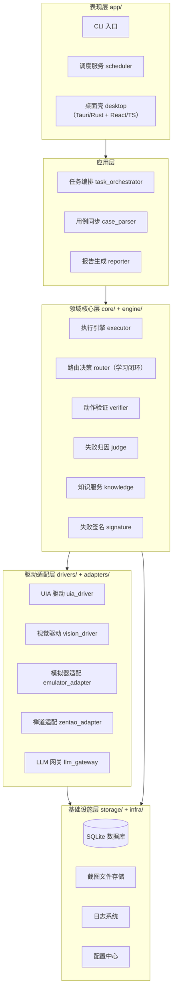

分层依赖规则：上层可依赖下层，`core/` 不依赖任何具体驱动（只定义 Port 协议）；`engine/` 只依赖 `core/contracts`；驱动通过注册表注入。

### 2.2 技术选型

| 领域 | 选型 | 理由 |
|---|---|---|
| 语言（引擎） | Python 3.11+ | pywinauto / opencv / LLM SDK 生态最全 |
| UIA 驱动 | pywinauto（uia backend） | Qt Widgets 经 QAccessible 暴露 UIA 树，免费成熟 |
| 视觉驱动 | OpenCV 模板匹配 + 公司内网部署多模态模型（OpenAI 兼容，grounding/描述双能力） | L0/L1/L2 成本阶梯；数据不出内网、成本可控、延迟稳定 |
| 截图 | mss / PIL ImageGrab | 高帧率抓屏 |
| 数据库 | SQLite（WAL 模式） | 单机零运维，轨迹量级足够；预留 PG 迁移 |
| 数据模型 | pydantic v2 | DSL 校验 + JSON Schema 自动导出 |
| LLM 接入 | 统一 LlmPort 网关（直接对话 API，OpenAI 兼容，对接公司内网部署模型） | 解析/归因/VLM 三类调用收敛，成本可审计；agent 集成策略见 11.1 |
| 调度 | 内置 `app/scheduler.py`（间隔轮询；可被系统 cron 调 `schedule --once`） | 不引入 APScheduler 依赖，单机串行调度语义更可控 |
| 桌面壳 | **Tauri 2（Rust）+ React 18 + TypeScript** | 壳体轻量（内存/安装体积远低于 Electron）；Rust 侧原生进程监督与系统 API，团队 Rust 熟练；React 生态支撑报告钻取/人审界面 |
| 壳↔引擎 IPC | JSON-RPC 2.0 over 127.0.0.1 WebSocket | Tauri 壳与 Python sidecar 双向通信（命令请求 + 事件推送） |
| 图表 | Mermaid（文档内）/ 手写零依赖 SVG（应用内） | 通过率环、根因条形、耗时拆分条均为纯 SVG 组件，未引入 ECharts；报告本体为 Markdown |

### 2.3 代码目录结构

```
testpilot/
├── app/                        # 入口与表现层
│   ├── cli.py                  # 命令行：db-init/doctor/case/suite/task/run/kb/explore/serve/schedule
│   ├── scheduler.py            # 定时回归调度（内置间隔轮询，可独立于壳运行）
│   └── desktop/                # Tauri 2 桌面壳（Rust）+ React 前端
│       ├── src-tauri/          # Rust 壳：sidecar 进程监督、JSON-RPC 转发、资源白名单
│       │   ├── src/main.rs     # 壳入口：启动/健康检查/重启 sidecar、窗口与日志抽屉
│       │   └── tauri.conf.json # bundle.resources 递归挂载 binaries/sidecar/**/*（非 externalBin）
│       └── src/                # React 18 + TS：报告钻取 / 人审队列 / DSL 审阅 / 设置
│           ├── pages/          # Cases · Suites · Runs · RunDetail · KBReview · DslReview · Tasks · Settings
│           └── bridge.ts       # RPC/事件类型化封装
├── core/                       # 领域核心（零平台依赖）
│   ├── contracts.py            # 所有 Port 协议与值对象（含 DriverManifest、NullAbort）
│   ├── dsl.py                  # DSL pydantic 模型（含 uncertain/notes）
│   ├── registry.py             # 驱动注册表（manifest + factory，DriverManifest 从 contracts 再导出）
│   ├── errors.py               # 异常体系 + JSON-RPC 错误码
│   └── events.py               # 领域事件（StepFinished/CaseFinished/RunFinished）
├── engine/                     # 执行域
│   ├── executor.py             # 执行引擎主循环（能力门禁/尝试链/模板沉淀/事件）
│   ├── router.py               # 双驱动路由决策（global<case<step 三级覆盖）+ 学习重排
│   ├── verifier.py             # 动作后验证（四类断言）
│   ├── judge.py                # 失败归因（规则 + 知识库 + LLM）
│   ├── orchestrator.py         # 任务编排（本地优先建任务/失败复跑/回写/报告）
│   └── stats.py                # 驱动降级率 / 用例稳定性 / 两次 run 对比
├── drivers/                    # 驱动适配层（GUI 依赖一律惰性导入）
│   ├── uia_driver.py           # pywinauto 封装（+read_text；locator 支持 index；就绪判据 ready_control）
│   ├── vision_driver.py        # 模板匹配 + VLM 定位 + L2→L1 模板沉淀
│   └── emulator_adapter.py     # 设备模拟器 WebSocket 客户端（hello 握手/能力清单）
├── adapters/                   # 外部系统适配
│   ├── zentao_adapter.py       # 禅道同步门面（认证自愈/分页/回读校验/回写重试）
│   ├── llm_gateway.py          # LLM/VLM 统一网关（token 计量/结构校验/误标 uncertain）
│   └── prompts.py              # 版本化 prompt 模板（parse/ground/verify/judge）
├── knowledge/                  # 知识域
│   ├── signature.py            # 失败签名
│   └── service.py              # 元素库/失败库/case_ctx/env_compat/预取/相似匹配/路由统计
├── storage/                    # 持久化
│   ├── db.py                   # SQLite 连接与幂等迁移（WAL）
│   ├── recorder.py             # 轨迹记录器（step_trace + 尝试摘要 + 截图）
│   ├── repos.py                # 各表仓储 + run 归档
│   └── shotstore.py            # 截图三级目录存储
├── infra/                      # 横切基础设施
│   ├── abort.py                # 协作取消（AbortSignal）
│   ├── logsys.py               # 结构化日志（JSON 走 stderr + run 日志抽取）
│   ├── events.py               # 领域事件总线（CLI 空转 / 壳形态订阅推送）
│   ├── dpi.py                  # DPI 感知与坐标空间归一
│   ├── imaging.py              # 截图解码/中文路径读写/差异高亮（run.shotDiff 用）
│   ├── opencv.py               # cv2 装载韧性（引导文件损坏时直装 cv2.pyd）
│   └── winver.py               # 被测 exe 版本探测（env_snapshot）
├── report/
│   └── reporter.py             # Markdown 报告（轨迹/原文对照/降级统计/归因分布/稳定性/env 矩阵）
├── config/
│   ├── settings.py             # 配置加载（yaml + ${ENV} 展开 + TESTPILOT_HOME 数据根重定位）
│   ├── service.py              # 设置页配置覆盖层（describe/apply/reset，秘密字段只读）
│   └── default.yaml
├── explore/                    # M5+ 探索（工具层就绪，agent 运行时由外部接入）
│   ├── toolbox.py              # 驱动/模拟器 → agent 工具白名单
│   ├── session.py              # 探索会话固化回 DSL 草稿
│   └── mcp_server.py           # 模拟器 MCP server（stdio，JSON-RPC 子集）
├── case_parser.py              # 用例应用服务（拉取/同步/解析/人审/导出导入）
├── suites.py                   # 测试方案应用服务
├── rpc.py                      # JSON-RPC 2.0 over WebSocket（壳 ↔ 引擎，见 2.5）
└── pyproject.toml
（仓库根还含 tests/（含 conformance/）、packaging/、scripts/、tools/、docs/）

### 2.4 驱动插件化与注册表

驱动以 manifest 自描述，引擎通过注册表创建，**新增驱动（如 Squish、WinAppDriver）不改引擎代码**：

```python
# 驱动 manifest 字段
@dataclass
class DriverManifest:
    kind: str                    # "interaction" | "device" | "external"
    name: str                    # "uia" | "vision" | "emulator" | ...
    version: str
    capabilities: frozenset[str] # {"click","input","select","grab","wait_ready",...}
    config_schema: dict          # JSON Schema（前端表单 + 配置校验共用）
    entry: str                   # 工厂入口 "testpilot.drivers.uia_driver:create"
    priority: int = 100          # 同 kind 多驱动时的默认次序
```

注册表负责：manifest 注册 → 配置校验（JSON Schema）→ 工厂调用 → 能力查询。所有驱动必须通过 `DriverConformanceTest`（定位/操作/截图/超时/取消/幂等语义）方可注册——延续 IssuePilot 的质量门禁约定。

### 2.5 部署形态与进程架构（Tauri 壳 + Python sidecar）

平台有两种运行形态，共享同一 Python 引擎，**业务逻辑只写一份**：

1. **CLI 形态**（M1~M3 主用）：`testpilot run` 直接驱动引擎，无人值守回归/CI 集成，不需要壳
2. **桌面壳形态**（M4）：Tauri 2（Rust）壳承载 React 前端；Python 引擎作为 sidecar 进程被壳监督管理

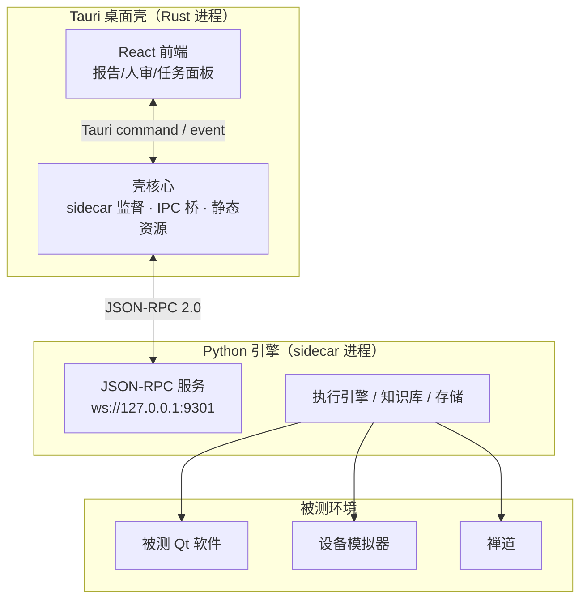

职责边界：

| 组件 | 职责 | 明确不做 |
|---|---|---|
| Rust 壳 | sidecar 启动/健康检查/崩溃重启（指数退避，上限 3 次）；前端命令转发；报告与截图静态资源服务；窗口/托盘/自动更新 | 不含任何测试业务逻辑 |
| Python 引擎 | 全部业务：执行、知识库、存储、禅道/模拟器/LLM 适配、RPC 服务 | 不依赖壳存在（CLI 形态独立运行） |
| React 前端 | 纯视图：报告钻取、人审队列、DSL diff、任务面板 | 不直连数据库/外网 |

IPC 协议（壳 ↔ 引擎，JSON-RPC 2.0 over `127.0.0.1:9301` WebSocket，与模拟器端口分离）：

| 方法 | 方向 | 说明 |
|---|---|---|
| `health` / `shutdown` | 壳→引擎 | 健康检查（DB/驱动/禅道/模拟器/DPI/资源路径）与优雅退出 |
| `case.pull` / `case.sync` / `case.list` / `case.detail` / `case.export` / `case.import` / `case.parse` | 壳→引擎 | 按ID拉取、增量同步、本地列表（含 sync_status）、详情、导出/导入草稿、LLM 解析（`allStale` 批量重解析） |
| `suite.list` / `suite.detail` / `suite.create` / `suite.update` / `suite.delete` | 壳→引擎 | 测试方案 CRUD（含用例集、前置场景、方案级驱动配置） |
| `task.create` / `task.run` / `task.abort` / `task.list` / `task.detail` / `task.syncPending` | 壳→引擎 | 任务创建（引用方案或临时选例）、启动执行（可覆盖 mode / caseRetry）、协作中止、列表/详情、sync_pending 补偿（可选单任务） |
| `run.list` / `run.detail` / `run.caseDetail` / `run.stepTrace` / `run.report` / `run.compare` / `run.shotDiff` | 壳→引擎 | 报告四层钻取 + 报告再生成 + 两次 run 对比 + 前后截图差异高亮（按需生成并缓存） |
| `kb.pending` / `kb.confirm` / `kb.reject` / `kb.setDisposition` / `kb.caseCtxList` / `kb.caseCtxSave` / `kb.caseCtxDelete` / `kb.envCompat` | 壳→引擎 | 人审队列操作、处置策略修正、用例上下文（case_ctx）维护、环境通过率矩阵 |
| `dsl.review` / `dsl.save` / `dsl.accept` / `dsl.reject` | 壳→引擎 | DSL 草稿审阅/保存/通过/拒绝 |
| `config.describe` / `config.apply` / `config.reset` / `config.overrideText` | 壳→引擎 | 设置页：字段描述（分组/类型/默认值）、写入覆盖层、恢复默认、覆盖层原文 |
| 事件 `run.progress` / `case.finished` / `step.finished` | 引擎→壳 | 进度推送（复用 `core/events.py` 领域事件序列化；LLM token 用量随 run 统计落库，不再单发 `llm.usage` 事件） |

> 说明：设计早期版本的 `case.detail` / `step.detail` 与用例管理组的 `case.detail` 重名，实现收敛为 `run.caseDetail` / `run.stepTrace`（决策 D6）；实际方法共 43 个，以 `testpilot.rpc.RpcService.methods()` 为准。

前端信息架构（React 页面）：

| 页面 | 内容 |
|---|---|
| Cases | 用例管理：本地用例列表（按 ID 拉取入库、增量同步、sync_status 状态） |
| Suites | 测试方案：本地用例多选组建方案，持久化保存，任务直接引用 |
| Runs / RunDetail | run 列表 → 通过率 → 用例明细 → step 轨迹 + 前后双截图对照 + 用例步骤原文对照；另含稳定性列/抖动卡、两次 run 回归对比面板、复跑徽章与「第几次执行」切换、截图差异高亮 |
| KBReview | 待人审失败知识队列：签名、根因草稿、证据链跳转、相似历史对照；另含用例上下文（case_ctx）页签（env_compat 矩阵落在 RunDetail 概览，见 14.3） |
| DslReview | DSL 草稿 vs 禅道原文 diff，不确定标记高亮 |
| Tasks | 任务创建（**选测试方案**或临时选用例、驱动模式）、调度状态、禅道回写状态（sync_pending 补偿入口） |
| Settings | 分组表单：34 字段 9 分组由引擎 `config.describe` 驱动生成；密钥类字段不进入表单（写入被引擎拒绝）；含覆盖层 YAML「高级」页签 |

页面布局线框、组件规范与交互约定详见[第 14 章](#14-桌面壳-ui-设计react)。

打包形态（沿用 ZentaoDsh sidecar 经验）：Python 引擎经 PyInstaller（onedir）产出 `testpilot-sidecar/`，在 `tauri.conf.json` 以 **`bundle.resources` 递归 glob（`binaries/sidecar/**/*`）** 挂载 —— 不使用 `externalBin`（其只搬单个可执行文件，onedir 的 `_internal/` 会静默丢失，见 13 章与 D7/D11）；Tauri bundle 产出便携安装包，**目标机器无需预装 Python / Node**——与 ZentaoDsh 的便携性硬约束一致；构建产物统一输出到顶层 `dist`。安装后由壳把 sidecar 的 cwd 与 `TESTPILOT_HOME` 指向可写数据根（`%LOCALAPPDATA%\\TestPilot`），引擎据此重定位相对产出路径（D9）。

---

## 3. 数据流与数据模型

### 3.1 用例生命周期数据流（离线）

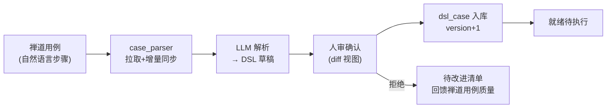

要点：解析结果人审后才生效；每次修改 `version+1`，执行记录钉住当时版本，保证归因可比。

### 3.2 执行时数据流（在线）

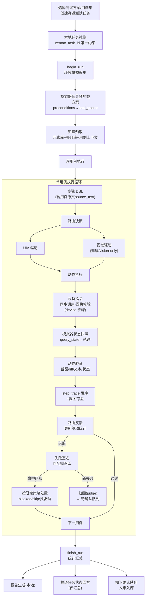

### 3.3 知识闭环数据流

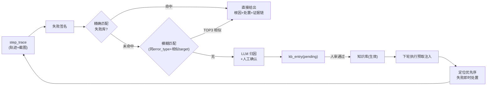

### 3.4 本地数据模型

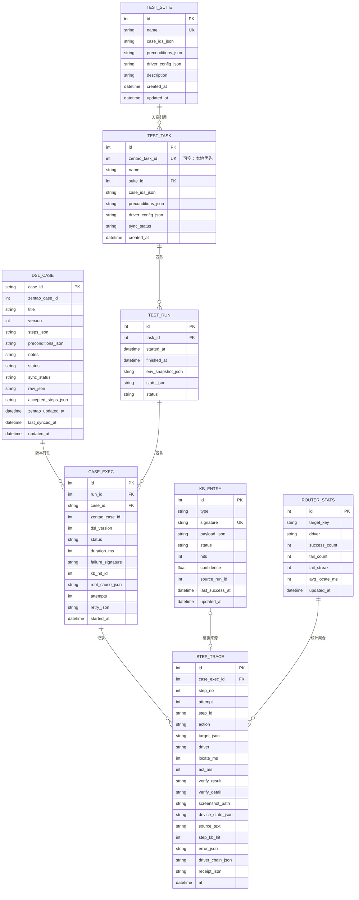

DDL（SQLite，WAL 模式）：

```sql
CREATE TABLE IF NOT EXISTS dsl_case (
  case_id          TEXT PRIMARY KEY,          -- TC-1024
  zentao_case_id   INTEGER,
  title            TEXT NOT NULL DEFAULT '',
  version          INTEGER NOT NULL DEFAULT 1,   -- 草稿=0，首次人审通过=1
  steps_json       TEXT NOT NULL,             -- Step 含 source_text / uncertain
  preconditions_json TEXT NOT NULL DEFAULT '[]',
  notes            TEXT NOT NULL DEFAULT '',  -- LLM 解析不确定点汇总（人审参考）
  status           TEXT NOT NULL DEFAULT 'draft',  -- draft|active|rejected|deprecated
  sync_status      TEXT NOT NULL DEFAULT 'synced', -- synced|stale|conflict
  raw_json         TEXT,                      -- 禅道原文快照（stale 重解析 / 三版对照）
  accepted_steps_json TEXT,                   -- 最近一次人审生效的 DSL 快照（冲突三版对照）
  zentao_updated_at TEXT,                     -- 禅道侧最后更新时间(变更检测)
  last_synced_at   TEXT,                      -- 本地最后同步时间
  updated_at       TEXT NOT NULL
);
CREATE INDEX IF NOT EXISTS idx_dsl_zentao ON dsl_case(zentao_case_id);
CREATE INDEX IF NOT EXISTS idx_dsl_status ON dsl_case(status, sync_status);

-- 测试方案：本地持久化的用例集（不是所有用例都需要测试）
CREATE TABLE IF NOT EXISTS test_suite (
  id               INTEGER PRIMARY KEY AUTOINCREMENT,
  name             TEXT NOT NULL UNIQUE,
  case_ids_json    TEXT NOT NULL,             -- 有序用例列表
  preconditions_json TEXT NOT NULL DEFAULT '[]',  -- 模拟器场景等前置(引用DSL preconditions汇总)
  driver_config_json TEXT NOT NULL DEFAULT '{}',  -- 方案级驱动配置覆盖(mode等)
  description      TEXT NOT NULL DEFAULT '',
  created_at       TEXT NOT NULL,
  updated_at       TEXT NOT NULL
);

CREATE TABLE IF NOT EXISTS test_task (
  id               INTEGER PRIMARY KEY AUTOINCREMENT,
  zentao_task_id   INTEGER UNIQUE,            -- 可空：M1 本地优先，M2 起回填禅道任务号
  name             TEXT NOT NULL,
  suite_id         INTEGER REFERENCES test_suite(id),  -- 来源方案(可空=临时选例)
  case_ids_json    TEXT NOT NULL,
  preconditions_json TEXT NOT NULL DEFAULT '[]',  -- 建任务时的方案前置场景快照
  driver_config_json TEXT NOT NULL DEFAULT '{}',
  sync_status      TEXT NOT NULL DEFAULT 'local', -- local|synced|sync_pending
  created_at       TEXT NOT NULL
);

CREATE TABLE IF NOT EXISTS test_run (
  id               INTEGER PRIMARY KEY AUTOINCREMENT,
  task_id          INTEGER NOT NULL REFERENCES test_task(id),
  started_at       TEXT NOT NULL,
  finished_at      TEXT,
  env_snapshot_json TEXT NOT NULL,            -- 被测版本/构建号/模拟器版本/机器/DPI/mode
  stats_json       TEXT NOT NULL DEFAULT '{}',
  status           TEXT NOT NULL DEFAULT 'running'  -- running|completed|aborted
);

CREATE TABLE IF NOT EXISTS case_exec (
  id               INTEGER PRIMARY KEY AUTOINCREMENT,
  run_id           INTEGER NOT NULL REFERENCES test_run(id),
  case_id          TEXT NOT NULL REFERENCES dsl_case(case_id),
  zentao_case_id   INTEGER,
  dsl_version      INTEGER NOT NULL,
  status           TEXT NOT NULL,             -- 瞬时 running；终态 pass|fail|blocked|skip|error
  duration_ms      INTEGER NOT NULL DEFAULT 0,
  failure_signature TEXT,
  kb_hit_id        INTEGER,
  root_cause_json  TEXT,                      -- 归因摘要（规则/KB/LLM）
  attempts         INTEGER NOT NULL DEFAULT 1,-- 执行次数（>1 表示发生失败复跑）
  retry_json       TEXT,                      -- 每次尝试的摘要（复跑才写）
  started_at       TEXT NOT NULL
);
CREATE INDEX IF NOT EXISTS idx_case_exec_run ON case_exec(run_id);
CREATE INDEX IF NOT EXISTS idx_case_exec_sig ON case_exec(failure_signature);

CREATE TABLE IF NOT EXISTS step_trace (
  id               INTEGER PRIMARY KEY AUTOINCREMENT,
  case_exec_id     INTEGER NOT NULL REFERENCES case_exec(id),
  step_no          INTEGER NOT NULL,
  attempt          INTEGER NOT NULL DEFAULT 1, -- 第几次执行（复跑时同一 case 有多份轨迹）
  step_id          TEXT NOT NULL,
  action           TEXT NOT NULL,
  target_json      TEXT,                      -- target 描述符快照（回放/归因）
  driver           TEXT,                      -- uia|vision|emulator（template 是定位方式，不是驱动）
  locate_ms        INTEGER,
  act_ms           INTEGER,
  verify_result    TEXT,                      -- pass|fail|unknown；无 verify 时为 NULL
  verify_detail    TEXT,                      -- 断言细节（含期望/实际）
  screenshot_path  TEXT,
  device_state_json TEXT,                     -- device 步骤后模拟器状态快照(query_state摘要)
  source_text      TEXT,                      -- 来源禅道原文步骤（轨迹对照）
  step_kb_hit      INTEGER,                   -- 本步骤命中知识条目
  error_json       TEXT,                      -- {type,message,stack,extra}
  driver_chain_json TEXT,                     -- 驱动尝试链（降级率统计）
  receipt_json     TEXT,                      -- device 回执 {step_id,cmd,ok,ms,error?}
  at               TEXT NOT NULL
);
CREATE INDEX IF NOT EXISTS idx_step_case ON step_trace(case_exec_id);

CREATE TABLE IF NOT EXISTS kb_entry (
  id               INTEGER PRIMARY KEY AUTOINCREMENT,
  type             TEXT NOT NULL,             -- element|failure|case_ctx|env_compat
  signature        TEXT NOT NULL,
  payload_json     TEXT NOT NULL,
  status           TEXT NOT NULL DEFAULT 'active',  -- pending|active|rejected|stale
  hits             INTEGER NOT NULL DEFAULT 0,
  confidence       REAL NOT NULL DEFAULT 1.0,
  source_run_id    INTEGER,
  last_success_at  TEXT,
  updated_at       TEXT NOT NULL
);
CREATE UNIQUE INDEX IF NOT EXISTS uk_kb_sig ON kb_entry(type, signature);

CREATE TABLE IF NOT EXISTS router_stats (
  id               INTEGER PRIMARY KEY AUTOINCREMENT,
  target_key       TEXT NOT NULL,
  driver           TEXT NOT NULL,
  success_count    INTEGER NOT NULL DEFAULT 0,
  fail_count       INTEGER NOT NULL DEFAULT 0,
  fail_streak      INTEGER NOT NULL DEFAULT 0,
  avg_locate_ms    INTEGER NOT NULL DEFAULT 0,
  updated_at       TEXT NOT NULL
);
CREATE UNIQUE INDEX IF NOT EXISTS uk_router ON router_stats(target_key, driver);
```

迁移语义（`storage/db.py`）：建表全部 `IF NOT EXISTS` + `PRAGMA foreign_keys=ON` + WAL，并对旧库做**幂等补齐** —— `_ADDED_COLUMNS` 14 列按需 `ALTER TABLE ADD COLUMN`（dsl_case 4 列、test_task 2 列、case_exec 3 列、step_trace 5 列）；`test_task` 若仍是早期 `zentao_task_id NOT NULL` 形态则做一次表重建：新表只搬运 `id/zentao_task_id/name/suite_id/case_ids_json/driver_config_json/created_at` 七列，`sync_status` 统一重置为 `'local'`（旧表若已有 `preconditions_json` 不在搬运名单，重建后回落到默认值）；重建期间临时关闭外键、完成后恢复。其余历史库缺列（如 `dsl_case.zentao_updated_at`、`case_exec.started_at`、`step_trace.at/screenshot_path/device_state_json/error_json/target_json`）不在补齐白名单内。因此上面 DDL 是"当前权威形态"，而不是只能新建库使用的一次性脚本。

截图按 `data/shots/{run_id}/{case_exec_id}/{step_no}_{phase}.png` 三级目录存盘，库内只存相对路径。`phase` 取 `before|after|error`。截图差异高亮图由 `run.shotDiff` 按需生成并缓存为同目录 `diff_{step_no}.png`（伴随 `diff_{step_no}.json` 记录变化统计）。

### 3.5 禅道交互边界

| 动作 | 方向 | 禅道 API 域 | 说明 |
|---|---|---|---|
| 拉取用例 | 禅道→本地 | 测试用例列表/详情 | 复用 zentao provider；增量同步按 updated_at |
| 创建测试任务 | 本地→禅道 | testtask-create | 带产品/版本/用例范围，拿回 zentao_task_id |
| 任务状态更新 | 本地→禅道 | testtask-edit（状态字段） | 仅状态+通过率汇总，不写执行明细 |
| 用例执行记录 | 仅本地 | — | 轨迹/截图/DSL版本/归因全在本地库 |

回写策略：任务结束时一次性回写（进行中→阻塞/完成），避免高频调用禅道；回写失败重试 3 次后本地标记 `sync_pending`，CLI 与桌面壳 Tasks 页均提供补偿入口。

实现补充（M1 本地优先，M2-1 起可选远端建任务）：`create_task` 默认只在本地落库（`test_task.sync_status='local'`）；配置 `zentao.create_task=true` 或显式 `--remote` / `remote:true` 时才调禅道建任务，成功即回填 `zentao_task_id`（`sync_status='synced'`），失败降级本地并标 `sync_pending`。`zentao_task_id` 保持 UNIQUE，创建后立即回读校验（断链防线）。

### 3.6 用例同步与测试方案（离线管理闭环）

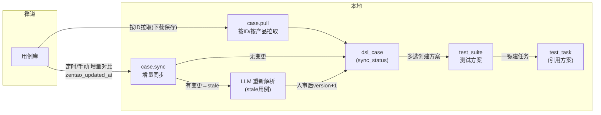

同步语义：

- **按 ID 拉取**：`case.pull(case_ids)` 拉取指定禅道用例（含步骤）存入本地；本地 `case_id` 以禅道 ID 派生，幂等
- **增量同步**：`case.sync(product_id)` 对比禅道 `updated_at`；无变更不动，有变更标 `sync_status=stale` 并提示 DSL 需重新解析（人审后 `version+1`，旧 run 记录仍钉住旧版本）
- **冲突**：本地 DSL 草稿未确认时禅道又更新 → `sync_status=conflict`，人审界面并列显示三版（禅道最新 / 本地草稿 / 本地已确认版本）
- **方案（test_suite）**：本地持久化用例集，含顺序、模拟器前置场景汇总、方案级驱动配置；创建任务时选方案即展开为 `case_ids` + `preconditions` 快照进 test_task，方案后续修改不影响历史任务
- **人审版本**：解析草稿 `version=0`，首次 `accept` 后 `version=1` 并冻结 `accepted_steps_json`；处于草稿态时远端再变更 → `conflict`，可并列比对"禅道最新 / 本地草稿 / 上次生效版本"三版

---

## 4. UML 设计

### 4.1 核心类图

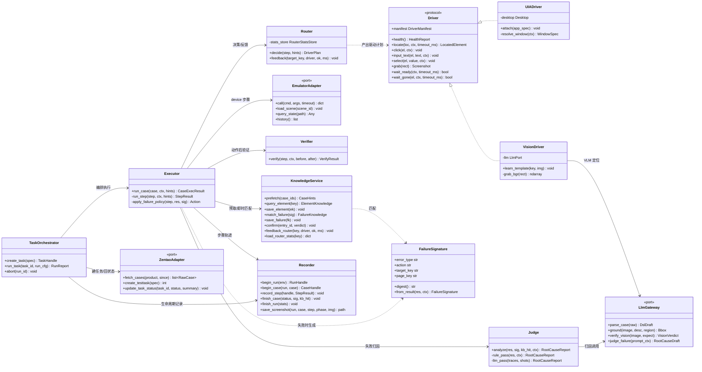

> **实现增补类（v1.6）**：`CaseService`（拉取/同步/解析/人审/导入导出）、`SuiteService`（方案 CRUD/展开快照）、`EngineStats`（`driver_stats`/`case_stability`/`compare_runs`）、`EventBus`（领域事件总线）、`ConfigService`（设置页覆盖层）、`ExploreToolBox`（M5+ 工具层）、`ShotStore`（截图存取）。`Executor` 的依赖在编排器构造期完成装配（含 registry 工厂绑定 LLM 注入的视觉驱动）。

### 4.2 任务执行序列图

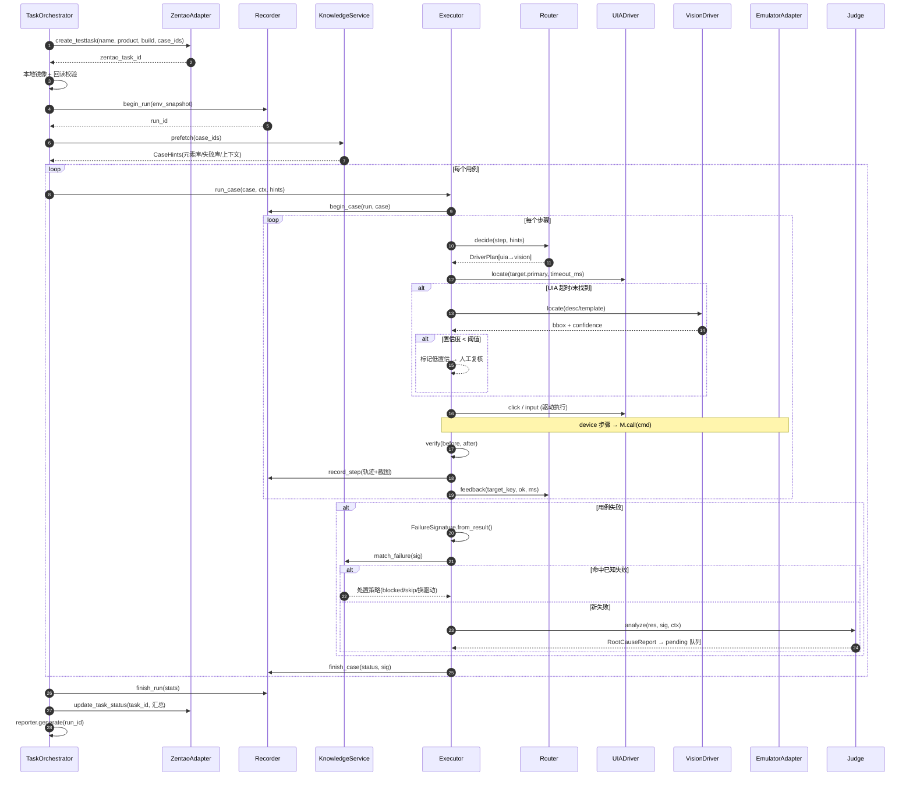

### 4.3 步骤执行状态机

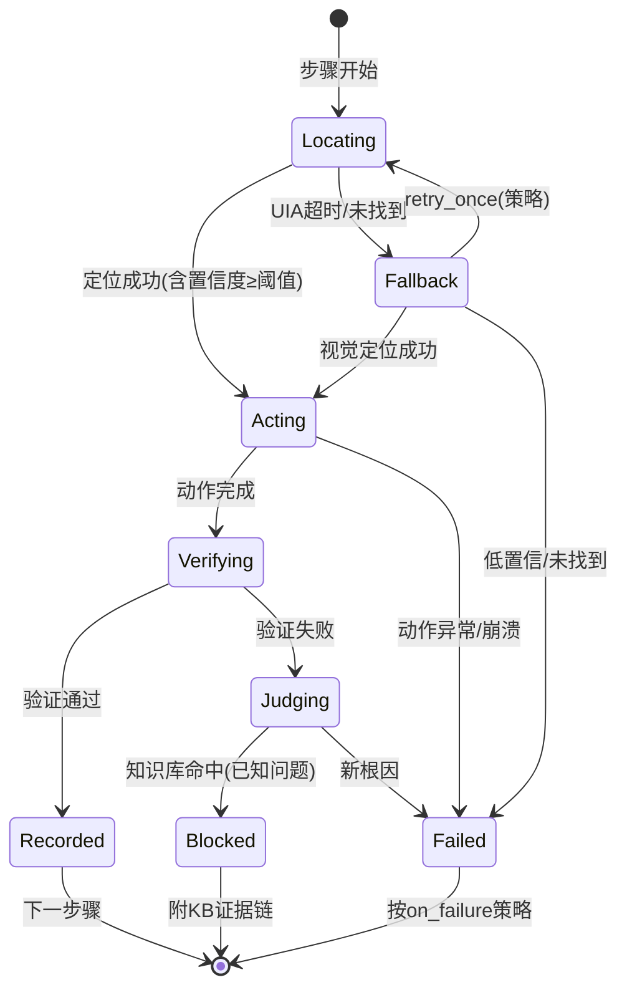

### 4.4 任务/运行状态机

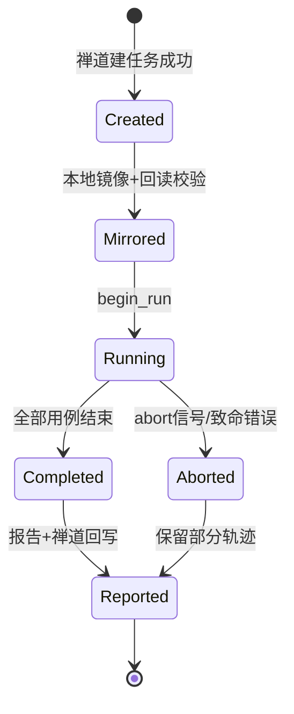

### 4.5 路由决策内部流程

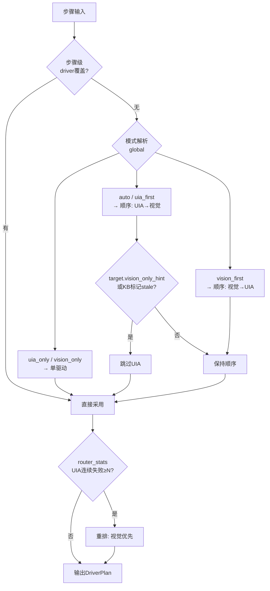

---

## 5. 模块接口

所有接口以 `core/contracts.py` 中的 `typing.Protocol` 定义（结构化类型，便于测试替身）。统一错误语义：驱动层抛 `core/errors.py` 中的异常，引擎层统一捕获转 `StepResult`。

> **实现对齐说明（v1.7）**：落地时端口做了**类型泛化**——下文骨架里的具名类型（`RawCase`/`TestTaskSpec`/`TaskSummary`/`DslDraft`/`GroundResult`/`VisionVerdict`/`JudgePromptCtx`/`RootCauseDraft`）在 `contracts.py` 中统一退化为 `dict/list/Any`，实现层再落具体值对象（如 `knowledge/signature.py:FailureSignature`、`knowledge/service.py:CaseHints/ElementKnowledge/FailureKnowledge/StatsRow`）；`KnowledgePort` 仅声明 6 个方法（`save_element`/`confirm` 实现在 `knowledge/service.py` 未进 Protocol）；`RpcService` 不是 `contracts.py` 的 Protocol，而是 `testpilot/rpc.py` 的具体类。`core/errors.py` 另含骨架外的 `LlmError`/`ZentaoError`/`RpcError` 与 JSON-RPC 错误码。

异常体系：

```python
class TestPilotError(Exception): ...          # 基类
class LocateError(TestPilotError):            # 定位失败
    def __init__(self, reason, confidence=None, searched=None): ...
class ActionError(TestPilotError): ...        # 操作失败(点击/输入异常)
class VerifyError(TestPilotError): ...        # 验证失败(含期望值/实际值)
class DeviceError(TestPilotError): ...        # 模拟器指令失败/超时
class AppError(TestPilotError): ...           # 被测程序崩溃/未就绪
class AbortRequested(TestPilotError): ...     # 协作取消信号
```

### 5.1 Driver（交互驱动协议）

```python
class Driver(Protocol):
    manifest: DriverManifest

    def health(self) -> HealthReport: ...
    def locate(self, loc: Locator, ctx: ExecContext,
               timeout_ms: int | None = None) -> LocatedElement: ...
    def click(self, el: LocatedElement, ctx: ExecContext) -> None: ...
    def input_text(self, el: LocatedElement, text: str, ctx: ExecContext) -> None: ...
    def select(self, el: LocatedElement, value: str, ctx: ExecContext) -> None: ...
    def grab(self, rect: Rect | None, ctx: ExecContext) -> Screenshot: ...
    def wait_ready(self, ctx: ExecContext, timeout_ms: int) -> bool: ...
    def wait_gone(self, el: LocatedElement, ctx: ExecContext,
                  timeout_ms: int) -> bool: ...
```

语义约定：
- `locate` 必须自超时（默认 3000ms，可被 `timeout_ms` 覆盖——`ui.wait` 长等待场景），超时抛 `LocateError`，**不重试**（重试是引擎/路由的职责）
- `wait_gone` 支撑 `ui.wait(state=gone)`：轮询控件消失，超时返回 `False`
- `click` / `input_text` 幂等性不保证（toggle 类控件），引擎靠 verify 检测副作用
- 所有方法可被 `AbortRequested` 打断

### 5.2 EmulatorAdapter（设备模拟器端口）

```python
class EmulatorPort(Protocol):
    def call(self, cmd: str, args: dict, timeout_s: float = 10.0) -> dict: ...
    def load_scene(self, scene_id: str) -> None: ...
    def query_state(self, path: str) -> Any: ...
    def history(self, limit: int = 100) -> list[dict]: ...
```

`call` 约定：指令级超时；返回 `{"ok": bool, "data": ..., "elapsed_ms": int}`；模拟器离线抛 `DeviceError`。`history` 供失败取证（交互时序回放）。

### 5.3 ZentaoAdapter（禅道端口）

```python
class ZentaoPort(Protocol):
    def fetch_cases(self, product_id: int, since: datetime | None = None) -> list[RawCase]: ...
    def create_testtask(self, spec: TestTaskSpec) -> int: ...
    def update_task_status(self, task_id: int, status: str, summary: TaskSummary) -> None: ...
```

### 5.4 LlmGateway（LLM 统一网关）

```python
class LlmPort(Protocol):
    def parse_case(self, raw: RawCase) -> DslDraft: ...
    def ground(self, image_b64: str, desc: str, region: Rect | None) -> GroundResult: ...
    def verify_vision(self, image_b64: str, expect: str) -> VisionVerdict: ...
    def judge_failure(self, ctx: JudgePromptCtx) -> RootCauseDraft: ...
```

网关统一记录：模型名、prompt 版本、token 用量（`usage.total_tokens`）、耗时；全部进日志与 run 统计（见第 10、11 节）。**未做货币化"成本"换算**，`stats` 仅 `calls/tokens/ms/errors`（`adapters/llm_gateway.py`）。

### 5.5 KnowledgeService（知识端口）

```python
class KnowledgePort(Protocol):
    def prefetch(self, case_ids: list[str]) -> CaseHints: ...
    def query_element(self, key: str) -> ElementKnowledge | None: ...
    def save_element(self, ek: ElementKnowledge) -> None: ...
    def match_failure(self, sig: FailureSignature) -> FailureKnowledge | None: ...
    def save_failure(self, fk: FailureKnowledge) -> None: ...
    def confirm(self, entry_id: int, verdict: Literal["active", "rejected"]) -> None: ...
    def feedback_router(self, key: str, driver: str, ok: bool, ms: int) -> None: ...
    def load_router_stats(self, target_key: str) -> dict[str, StatsRow]: ...
```

### 5.6 Recorder（轨迹记录端口）

```python
class RecorderPort(Protocol):
    def begin_run(self, env: dict) -> int: ...
    def begin_case(self, run_id: int, case: TestCase) -> int: ...
    def record_step(self, case_exec_id: int, res: StepResult,
                    attempt: int = 1) -> None: ...
    # 失败复跑：每次尝试的摘要（复跑才写；首次失败的签名/归因不因最终通过而丢失）
    def record_attempts(self, case_exec_id: int, attempts: list[dict]) -> None: ...
    def finish_case(self, case_exec_id: int, status: str, sig: str | None,
                    kb_hit: int | None, duration_ms: int = 0,
                    root_cause: dict | None = None) -> None: ...
    def finish_run(self, run_id: int, stats: dict) -> None: ...
    def save_screenshot(self, run_id: int, case_exec_id: int, step_no: int,
                        phase: str, img: bytes) -> str: ...
```

### 5.7 RpcService（壳↔引擎端口，见 2.5）

```python
class RpcService(Protocol):
    """JSON-RPC 2.0 over WebSocket（127.0.0.1:9301）。
    引擎侧启动于 CLI/壳两种形态；方法表见 2.5 IPC 协议。"""
    def dispatch(self, method: str, params: dict): ...      # 方法表分发（RPC 错误归一化）
    def methods(self) -> list[str]: ...                     # 43 个方法清单（壳启动自检/文档）
    async def serve(self, host: str, port: int) -> None: ...# 阻塞方法丢线程池，避免卡事件循环
    def publish(self, event: str, payload: dict) -> None: ...# 线程安全推送给所有订阅连接
```

实现要点：执行类方法走 `run_in_executor`（`_BLOCKING` 实现为 9 个：`task.run`/`task.create`/`case.pull`/`case.sync`/`case.parse`/`suite.create`/`suite.update`/`case.import`/`run.shotDiff`）；`RpcService` 订阅 `orchestrator.bus` 并把领域事件原样广播；`shutdown` 先 abort 运行中的任务再收服务循环。

---

## 6. DSL 规范

### 6.1 Action 一览

| Action | 说明 | 关键参数 | 驱动 |
|---|---|---|---|
| `app.launch` | 启动被测程序（test-mode） | `exe`, `args`, `title_re` | UIA |
| `app.close` | 关闭被测程序 | `mode: graceful\|kill` | UIA |
| `app.wait_ready` | 等就绪信号 | `timeout_ms` | UIA/测试端口 |
| `ui.click` | 点击控件 | `target` | UIA/视觉 |
| `ui.input` | 输入文本 | `target`, `value`, `clear: bool` | UIA |
| `ui.select` | 下拉/列表选择 | `target`, `value` | UIA |
| `ui.wait` | 等待控件出现/消失 | `target`, `state: exists\|gone` | UIA/视觉 |
| `vision.click` | 视觉专属点击 | `target(visual)` | 视觉 |
| `device.call` | 模拟器指令 | `cmd`, `args` | 模拟器 |
| `device.scene` | 加载场景预设 | `scene_id` | 模拟器 |
| `assert.ui` | UI 文本/属性断言 | `target`, `expect`, `op` | UIA |
| `assert.state` | 内部状态断言（测试端口/模拟器） | `path`, `expect` | 模拟器/端口 |
| `assert.vision` | 视觉语义断言 | `expect` | VLM |
| `sleep` | 硬等待（慎用，优先 wait_ready） | `ms` | — |

### 6.2 Target 描述符

```json
{
  "key": "btn.start_detect",
  "primary":  { "type": "uia", "name": "开始检测", "control_type": "Button" },
  "fallback": { "type": "visual", "desc": "主界面底部「开始检测」按钮" },
  "vision_only_hint": false
}
```

- `key`：稳定语义键，元素库与 router_stats 的索引（**必填**）
- `primary` / `fallback`：双通道定位
- `vision_only_hint: true`：自绘控件/图表区域，跳过 UIA 直达视觉
- 每个步骤可带 `source_text`（LLM 解析时携带的禅道原文步骤说明）：轨迹回放与 DSL 审阅时对照显示"用例要求 ↔ 执行动作"，人审与归因依据
- 每个步骤可带 `uncertain: true`（LLM 解析/结构校验不确定标记）：DslReview 黄徽章高亮，强制人审确认后才随 `accept` 生效（`TestCase.notes` 汇总不确定点）

### 6.3 断言规范

| 类型 | 语义 | 判定方 |
|---|---|---|
| `text` | 控件文本 `contains/equals/regex` | 规则（UIA 读取） |
| `state` | 内部状态路径值 | 规则（模拟器/测试端口） |
| `vision` | 截图语义（如"出现红色报警图标"） | VLM + 置信度 |
| `screenshot_diff` | 区域前后变化 ≥ 阈值 | 规则（OpenCV） |
| `none`（默认） | 不做验证，直接判 `pass` | — |

规则断言优先；`vision` 断言结果带 confidence，低于阈值判 `unknown` → 人工复核，不硬判 fail（防幻觉漏判/误判）。实现中 `VerifySpec.type` 为 5 个取值（含默认 `none`）；`text` 断言缺 target 时回退 `step.target.primary`，`state` 额外支持 `op=regex`。

### 6.4 完整示例

```json
{
  "case_id": "TC-1024",
  "zentao_case_id": 1024,
  "title": "常规样本A检测全流程",
  "version": 3,
  "preconditions": ["模拟器场景: normal_sample_a"],
  "steps": [
    { "id": "s1",  "action": "app.launch",  "args": { "exe": "target.exe", "title_re": ".*主窗口.*" } },
    { "id": "s2",  "action": "app.wait_ready", "timeout_ms": 20000 },
    { "id": "s3",  "action": "device.scene", "args": { "scene_id": "normal_sample_a" } },
    { "id": "s4",  "action": "ui.input", "target": { "key": "edit.sample_id", "primary": { "type": "uia", "name": "样本编号" } }, "value": "S001", "args": { "clear": true } },
    { "id": "s5",  "action": "ui.click", "target": { "key": "btn.start_detect", "primary": { "type": "uia", "name": "开始检测" }, "fallback": { "type": "visual", "desc": "主界面底部「开始检测」按钮" } },
      "verify": { "type": "screenshot_diff" } },
    { "id": "s6",  "action": "ui.wait", "target": { "key": "tbl.result", "primary": { "type": "uia", "control_type": "Table" } }, "args": { "state": "exists" }, "timeout_ms": 60000 },
    { "id": "s7",  "action": "assert.ui", "target": { "key": "tbl.result", "primary": { "type": "uia", "control_type": "Table" } }, "verify": { "type": "text", "expect": "S001", "op": "contains" } },
    { "id": "s8",  "action": "assert.state", "args": { "path": "/state/run", "expect": "completed" } },
    { "id": "s9",  "action": "assert.vision", "verify": { "type": "vision", "expect": "结果表格中S001行显示绿色完成标记" } }
  ]
}
```

---

## 7. 框架骨架代码

### 7.1 core/dsl.py（DSL 模型）

```python
"""DSL 数据模型 — 全平台唯一执行语言。"""
from enum import Enum
from typing import Any, Literal
from pydantic import BaseModel, Field


class DriverMode(str, Enum):
    AUTO = "auto"
    UIA_FIRST = "uia_first"
    VISION_FIRST = "vision_first"
    UIA_ONLY = "uia_only"
    VISION_ONLY = "vision_only"


class LocatorType(str, Enum):
    UIA = "uia"            # UIA 对象定位
    TEMPLATE = "template"  # OpenCV 模板匹配
    VISUAL = "visual"      # VLM 语义定位


class Locator(BaseModel):
    type: LocatorType
    name: str | None = None            # accessibleName / 控件文本
    automation_id: str | None = None   # UIA AutomationId
    control_type: str | None = None    # Button/Edit/Table...
    desc: str | None = None            # 语义描述（visual）
    template: str | None = None        # 模板图相对路径（template）
    region: tuple[int, int, int, int] | None = None  # 限定搜索区域 x,y,w,h
    index: int = 0                     # 多匹配时取第几个


class TargetDesc(BaseModel):
    key: str                           # 稳定语义键（元素库/router_stats 索引）
    primary: Locator
    fallback: Locator | None = None
    vision_only_hint: bool = False


class VerifySpec(BaseModel):
    type: Literal["text", "state", "vision", "screenshot_diff", "none"] = "none"
    target: Locator | None = None
    expect: str | None = None
    op: Literal["contains", "equals", "regex"] = "contains"
    timeout_ms: int = 5000


class OnFailure(str, Enum):
    ABORT = "abort"        # 终止本用例（默认）
    CONTINUE = "continue"  # 记录失败继续后续步骤
    RETRY = "retry"        # 原计划重试一次


class Step(BaseModel):
    id: str
    action: str
    source_text: str | None = None   # 来源禅道用例的原文步骤说明（轨迹对照用）
    target: TargetDesc | None = None
    value: str | None = None
    args: dict[str, Any] = Field(default_factory=dict)
    verify: VerifySpec = Field(default_factory=VerifySpec)
    driver: DriverMode | None = None   # 步骤级覆盖
    on_failure: OnFailure = OnFailure.ABORT
    timeout_ms: int = 10000
    uncertain: bool = False          # LLM 解析/结构校验不确定标记（DslReview 高亮，人审必看）


class TestCase(BaseModel):
    case_id: str                        # TC-xxx
    zentao_case_id: int | None = None
    title: str = ""
    version: int = 1
    preconditions: list[str] = Field(default_factory=list)
    steps: list[Step] = Field(default_factory=list)
    notes: str = ""                     # 解析备注（不确定项汇总，人审参考）
```

### 7.2 core/contracts.py（值对象与协议）

```python
"""领域契约 — 引擎只依赖本文件，不依赖具体驱动。"""
from typing import Any, Protocol, runtime_checkable
from dataclasses import dataclass, field
from enum import Enum

from .dsl import Locator, TestCase


Rect = tuple[int, int, int, int]  # x, y, w, h（物理像素）


class DriverKind(str, Enum):
    UIA = "uia"
    VISION = "vision"
    TEMPLATE = "template"
    EMULATOR = "emulator"


@dataclass
class DriverManifest:
    """驱动自描述清单（定义在 contracts；core/registry 再导出以保持兼容）。"""
    kind: str                      # interaction | device | external
    name: str                      # uia | vision | emulator | ...
    version: str
    capabilities: frozenset[str]   # click/input/select/grab/wait_ready...
    config_schema: dict = field(default_factory=dict)  # JSON Schema
    entry: str = ""                # "pkg.module:create"
    priority: int = 100


# ---------- 协作取消空对象 ----------

class NullAbort:
    """默认中止信号：永不请求取消（core 不依赖 infra 的空对象）。"""

    def request(self) -> None: ...
    @property
    def requested(self) -> bool: return False
    def check(self) -> None: ...


# ---------- 值对象 ----------

@dataclass
class ExecContext:
    """单用例执行上下文（贯穿所有驱动调用，用于日志关联与窗口解析）。

    ``abort`` 默认 ``NullAbort``（core 层不依赖 infra，保证 ``ctx.abort.check()``
    永不为空值解引用）；``attempt`` 为第几次执行（失败复跑时递增）。
    """
    run_id: int
    case_exec_id: int
    case: TestCase | None = None
    window_rect: Rect | None = None       # 当前被测窗口矩形（视觉驱动换算基准）
    app_handle: Any = None                # UIA 驱动的窗口句柄缓存
    abort: Any = field(default_factory=NullAbort)   # 协作取消信号
    extra: dict[str, Any] = field(default_factory=dict)
    attempt: int = 1                      # 第几次执行（失败复跑；轨迹按此区分）

    def check_abort(self) -> None:
        """检查点统一入口（驱动/执行器共用）。"""
        self.abort.check()


@dataclass
class LocatedElement:
    driver: DriverKind
    handle: Any            # UIA wrapper 或 bbox
    rect: Rect
    confidence: float = 1.0


@dataclass
class Screenshot:
    png: bytes
    rect: Rect | None = None


@dataclass
class HealthReport:
    ok: bool
    detail: str = ""


@dataclass
class VerifyResult:
    status: str            # pass | fail | unknown
    detail: str = ""
    confidence: float | None = None


@dataclass
class StepResult:
    step_no: int
    step_id: str
    action: str
    status: str            # pass | fail | blocked | skipped
    driver: str | None = None
    locate_ms: int = 0
    act_ms: int = 0
    # [{"driver","ok","ms","error"}, ...]：按尝试顺序的驱动链（降级率统计的数据源）
    driver_chain: list[dict] | None = None
    verify: VerifyResult | None = None
    screenshot_before: str | None = None
    screenshot_after: str | None = None
    device_state: Any = None          # device 步骤后模拟器状态快照摘要
    source_text: str | None = None    # 来源用例原文步骤（轨迹对照）
    target_json: dict | None = None   # target 描述符快照（回放/归因）
    error: dict | None = None
    kb_hit: int | None = None


@dataclass
class CaseExecResult:
    case_id: str
    status: str            # pass | fail | blocked | skip | error
    duration_ms: int = 0
    steps: list[StepResult] = field(default_factory=list)
    failure_signature: str | None = None
    kb_hit: int | None = None
    root_cause: dict | None = None    # 归因摘要（report/RunDetail 消费）


# ---------- 端口协议 ----------

@runtime_checkable
class Driver(Protocol):
    manifest: "DriverManifest"

    def health(self) -> HealthReport: ...
    def locate(self, loc: Locator, ctx: ExecContext,
               timeout_ms: int | None = None) -> LocatedElement: ...
    def click(self, el: LocatedElement, ctx: ExecContext) -> None: ...
    def input_text(self, el: LocatedElement, text: str, ctx: ExecContext) -> None: ...
    def select(self, el: LocatedElement, value: str, ctx: ExecContext) -> None: ...
    def grab(self, rect: Rect | None, ctx: ExecContext) -> Screenshot: ...
    def wait_ready(self, ctx: ExecContext, timeout_ms: int) -> bool: ...
    def wait_gone(self, el: LocatedElement, ctx: ExecContext,
                  timeout_ms: int) -> bool: ...


@runtime_checkable
class EmulatorPort(Protocol):
    def call(self, cmd: str, args: dict, timeout_s: float = 10.0) -> dict: ...
    def load_scene(self, scene_id: str) -> None: ...
    def query_state(self, path: str) -> Any: ...
    def history(self, limit: int = 100) -> list[dict]: ...


@runtime_checkable
class KnowledgePort(Protocol):
    def prefetch(self, case_ids: list[str]) -> Any: ...
    def query_element(self, key: str) -> Any: ...
    def match_failure(self, sig: Any) -> Any: ...
    def save_failure(self, fk: Any) -> None: ...
    def feedback_router(self, key: str, driver: str, ok: bool, ms: int) -> None: ...
    def load_router_stats(self, target_key: str) -> dict: ...


@runtime_checkable
class RecorderPort(Protocol):
    def begin_run(self, env: dict) -> int: ...
    def begin_case(self, run_id: int, case: TestCase) -> int: ...
    def record_step(self, case_exec_id: int, res: StepResult,
                    attempt: int = 1) -> None: ...
    def record_attempts(self, case_exec_id: int, attempts: list[dict]) -> None: ...
    def finish_case(self, case_exec_id: int, status: str, sig: str | None,
                    kb_hit: int | None, duration_ms: int = 0,
                    root_cause: dict | None = None) -> None: ...
    def finish_run(self, run_id: int, stats: dict) -> None: ...
    def save_screenshot(self, run_id: int, case_exec_id: int, step_no: int,
                        phase: str, img: bytes) -> str: ...


@runtime_checkable
class LlmPort(Protocol):
    def parse_case(self, raw: dict) -> dict: ...
    def ground(self, image_b64: str, desc: str, region: Rect | None) -> dict: ...
    def verify_vision(self, image_b64: str, expect: str) -> dict: ...
    def judge_failure(self, ctx: dict) -> dict: ...


@runtime_checkable
class ZentaoPort(Protocol):
    def fetch_cases(self, product_id: int, since: Any = None) -> list: ...
    def create_testtask(self, spec: dict) -> int: ...
    def update_task_status(self, task_id: int, status: str, summary: dict) -> None: ...
```

### 7.3 core/registry.py（驱动注册表）

```python
"""驱动注册表 — manifest 自描述 + 工厂创建，扩驱动不改引擎。"""
import importlib
from typing import Callable

from .contracts import DriverManifest      # 值对象定义在 contracts，本模块再导出
from .errors import TestPilotError


class DriverRegistry:
    def __init__(self) -> None:
        self._manifests: dict[str, DriverManifest] = {}
        self._factories: dict[str, Callable[[dict], Driver]] = {}

    def register(self, manifest: DriverManifest) -> None:
        if manifest.name in self._manifests:
            raise TestPilotError(f"驱动已注册: {manifest.name}")
        self._manifests[manifest.name] = manifest

    def bind_factory(self, name: str, factory: Callable[[dict], Driver]) -> None:
        """绑定已加载的工厂；未绑定时按 manifest.entry 懒加载。"""
        self._factories[name] = factory

    def create(self, name: str, cfg: dict) -> Driver:
        if name not in self._manifests:
            raise TestPilotError(f"未知驱动: {name}")
        factory = self._factories.get(name)
        if factory is None:
            mod_path, fn = self._manifests[name].entry.rsplit(":", 1)
            factory = getattr(importlib.import_module(mod_path), fn)
            self._factories[name] = factory
        return factory(cfg)

    def names(self, kind: str | None = None) -> list[str]:
        ms = [m for m in self._manifests.values() if kind is None or m.kind == kind]
        return [m.name for m in sorted(ms, key=lambda m: m.priority)]

    def capabilities(self, name: str) -> frozenset[str]:
        return self._manifests[name].capabilities
```

> 实现增补：新增 `has_factory(name) -> bool`（编排器据此判断工厂是否已绑定）；`_factories` 的值类型/`create` 返回标注放宽为 `Callable[[dict], object]`（避免注册表模块导入驱动造成 GUI 依赖）。

### 7.4 config/default.yaml

```yaml
app:
  name: TestPilot
  db: ./data/testpilot.db
  screenshot_root: ./data/shots
  report_root: ./data/reports
  test_app_version: ""        # 手工覆盖被测程序版本（留空=从 test_app_exe 探测）
  test_app_exe: ""            # 被测程序主 exe；填了则读文件版本写入 env_snapshot

driver:                       # 全局驱动路由与判定阈值（Router/Verifier/Executor 读取）
  mode: auto               # auto | uia_first | vision_first | uia_only | vision_only
  vision_min_confidence: 0.70
  retry_on_failure: false     # true=定位超时类失败自动重试一次
  case_retry: 0               # 失败用例复跑次数（0=关闭，上限 3；flake 过滤）

uia:                          # UIA 驱动自身配置
  backend: uia
  app_launch_timeout_s: 30
  input_mode: keys            # keys | set_text
  uia_timeout_ms: 3000
  ready_poll_ms: 200
  # ready_control: {control_type: StatusBar}   # 可选：就绪判据控件

vision:
  grab_backend: mss           # mss | pil
  template_dir: ./data/templates
  template_threshold: 0.86
  vision_min_confidence: 0.70
  locate_poll_ms: 300         # 模板匹配轮询间隔（VLM 单次尝试，不受此影响）
  learn_from_vlm: true        # VLM 命中后自动沉淀模板（L2→L1）
  vlm:                     # 公司内网部署多模态模型（OpenAI 兼容）
    model: "company-vlm"   # 内网模型名，按公司部署填写
    api_base: "http://vlm.internal.example:8000/v1"
    api_key_env: "VLM_API_KEY"
    timeout_s: 30

emulator:
  endpoint: "ws://127.0.0.1:9300"
  connect_timeout_s: 5
  call_timeout_s: 10
  protocol_ver: "1.0"

rpc:                       # 壳 ↔ 引擎（见 2.5 IPC 协议）
  host: "127.0.0.1"
  port: 9301

desktop:                   # Rust 壳行为（Tauri 侧读取）
  sidecar:
    supervised: true       # 壳监督：崩溃自动重启（指数退避，上限 3 次）
    restart_max: 3
    health_interval_s: 10

llm:                        # 公司内网部署模型（OpenAI 兼容对话接口）
  model: "company-llm"      # 内网模型名，按公司部署填写
  api_base: "${LLM_API_BASE}"   # 例: http://llm.internal.example:8000/v1
  api_key_env: "LLM_API_KEY"
  temperature: 0.1
  max_tokens: 4096
  timeout_s: 60

zentao:
  base_url: "https://zentao.example.com"
  token_env: "ZENTAO_TOKEN"
  product_id: 1
  sync_interval_min: 60
  create_task: false       # true=建任务时同步在禅道创建（account/password 可用环境变量提供）

log:
  level: INFO
  dir: ./logs
  per_run_file: true       # 额外落 logs/testpilot.log，run 结束抽取为 reports/{run}/run.log
  llm_usage: true          # 记录每次 LLM 调用 token/耗时

knowledge:
  fuzzy_top_n: 3
  similar_top_n: 3         # 报告/RunDetail 的"相似历史对照"条数
  element_stale_days: 30   # 元素知识超期未命中 → 降权
  router_fail_streak: 3    # UIA 连续失败 N 次后重排
```

> 配置加载（`config/settings.py`）：内置 yaml → `${ENV}` 展开 → 按 `TESTPILOT_HOME` 重定位相对产出路径 → 合并设置页写入的覆盖层（`config.override.yaml`）；`TESTPILOT_NO_OVERRIDE=1` 可跳过覆盖层用于排障。设置页 **34 字段/9 分组**由 `config/service.py` 的 `EDITABLE`（字段规格，只暴露引擎有读取点的字段，由 `tests/test_settings.py` key-spec 门禁反向校验）与 `GROUPS`（分组展示顺序）定义；密钥类字段**不进入表单**（`SECRET_LIKE` 匹配的字段路径写入覆盖层会被引擎拒绝），仅经环境变量注入。

### 7.5 日志设计（infra/logsys.py）

```python
"""结构化日志 — run/case/step 三级上下文自动注入。"""
import contextvars, json, logging, sys, time
from pathlib import Path

_run_id = contextvars.ContextVar("run_id", default=None)
_case_id = contextvars.ContextVar("case_id", default=None)
_step_id = contextvars.ContextVar("step_id", default=None)


class JsonFormatter(logging.Formatter):
    def format(self, record: logging.LogRecord) -> str:
        payload = {
            "ts": time.strftime("%Y-%m-%dT%H:%M:%S", time.localtime(record.created)),
            "level": record.levelname,
            "logger": record.name,
            "msg": record.getMessage(),
            "run_id": _run_id.get(),
            "case_id": _case_id.get(),
            "step_id": _step_id.get(),
        }
        if record.exc_info:
            payload["exc"] = self.formatException(record.exc_info)
        for k in ("driver", "target_key", "locate_ms", "llm_model", "llm_tokens",
                  "llm_ms", "sig", "kb_hit"):
            if hasattr(record, k):
                payload[k] = getattr(record, k)
        return json.dumps(payload, ensure_ascii=False)


def setup_logging(cfg: dict) -> logging.Logger:
    root = logging.getLogger("testpilot")
    root.setLevel(getattr(logging, str(cfg.get("level", "INFO")).upper(), logging.INFO))
    for h in list(root.handlers):      # 幂等：重复调用不叠加 handler
        root.removeHandler(h); h.close()
    root.propagate = False

    # 日志走 stderr，stdout 留给命令结果（CLI 输出必须是可解析的纯 JSON）
    stream = logging.StreamHandler(sys.stderr)
    stream.setFormatter(JsonFormatter())
    root.addHandler(stream)

    if cfg.get("per_run_file"):
        log_dir = Path(cfg.get("dir", "./logs"))
        log_dir.mkdir(parents=True, exist_ok=True)
        fh = logging.FileHandler(log_dir / "testpilot.log", encoding="utf-8")
        fh.setFormatter(JsonFormatter())
        root.addHandler(fh)
    return root


def bind_run(run_id: int) -> None: _run_id.set(run_id)
def bind_case(case_id: str) -> None: _case_id.set(case_id)
def bind_step(step_id: str) -> None: _step_id.set(step_id)
```

约定：每个 run 结束时由 `extract_run_log()` 将 `logs/testpilot.log` 中 `run_id` 匹配行抽取为 `data/reports/{run_id}/run.log`（JSONL，便于检索）。业务字段经白名单进载荷，实现白名单为 **22 键**：`driver/target_key/step_no/action/cmd/ms/locate_ms/act_ms/status/llm_model/llm_tokens/llm_ms/prompt_version/sig/kb_hit/case_exec_id/task_id/suite_id/confidence/phase/count` + `run_id_`（后者无生产者，为历史残留键），防止 `extra` 乱塞导致日志膨胀。此外 `setup_logging` 的 handler 关闭有 try/except 兜底、`extra` 在异常栈之前写入（JSON 键序与骨架略不同）。

---

## 8. 核心自动化控制实现

> **实现状态说明（v1.7）**：本章 8.1~8.14 的代码为设计期骨架，**均已按此实现并做了工程化增补**。骨架与实现的差异不再逐段改写，统一汇总如下（逐项细节见附录 C）。个别模块存在**结构差异**（如 8.9 `Judge` 构造不含 `recorder`、kb_hit 判定前置；8.10 禅道同步门面 `ZentaoHttp` 自包含于 adapter 模块，M2-3 收编后移植的 async `ZentaoClient` 已删除），一律以 `testpilot/` 代码为准：
>
> | 模块 | 实现增补（相对骨架） |
> |---|---|
> | `engine/executor.py` | 领域事件发布（step/case 级）；驱动能力门禁（`_require`，不支持的动作抛 `ActionError` 而非 `AttributeError`）；动作不再换驱动重试（可能已产生副作用）；驱动尝试链 `driver_chain`；每步失败即写路由反馈；`ui.input clear` 能力探测；`sleep` 分片轮询可取消；`vision.click`；支持 `case_ctx` 场景预加载（失败不阻断）；元素知识自动积累；VLM 命中后模板沉淀（L2→L1）；`case_exec` 收尾由 `run_case` 闭合 |
> | `engine/router.py` | 驱动模式三级覆盖：`step.driver` > 方案/任务 `hints.driver_mode` > 全局 `cfg.driver.mode`；未知模式回退 auto |
> | `engine/judge.py` | 知识库命中直接产出参考结论（不重复入库）；规则类别扩展（dsl_error/verify_failed 等）；类别→处置映射（timing→retry_ready、product_bug→block_known）；相似历史对照 TOP N；规则高置信结论可直接 `active`，其余入 `pending` 待人审 |
> | `engine/orchestrator.py` | 建任务**本地优先**（禅道可选/失败降级 `sync_pending`）；建任务前可执行性门禁（`--force` 绕过）；**失败用例复跑**（flake 过滤，复用同一 case_exec，上限 3，三级覆盖）；`env_compat` 汇总；LLM 用量差值入 stats；`resource_paths()` 供壳注册资源白名单；`health()` 自检；`sync_pending_tasks()` 单任务/全量补偿 |
> | `knowledge/service.py` | 四类条目全部落地：元素库（自动积累+超期降权）、失败库（精确/模糊+`hits` 计数+相似历史）、`case_ctx`（人审维护：场景/已知坑/备注，字段增量合并）、`env_compat`（被测版本×用例集通过率矩阵）；`avg_locate_ms` 用增量均值（非 EMA） |
> | `drivers/*` | 全部方法内惰性导入（无 GUI 依赖环境可 import/可跑门禁）；UIA 增 `read_text` 方法、locator 支持 `index`（映射 `found_index`）、就绪判据配置 `ready_control`；视觉增 L2→L1 模板沉淀与模板超时轮询、PIL 后备、中文路径读写；模拟器增 `MANIFEST`/`connected`/`try_capabilities`/`protocol_version` |
> | `adapters/zentao_adapter.py` | 同步门面自包含（`ZentaoHttp` 定义在本模块内，是**唯一**禅道 HTTP 实现——移植的 async `ZentaoClient`（bug 域）在本仓零引用，M2-3 收编时删除）；401/403 重登重放、分页拉取、创建回读校验、回写重试 3 次；另含 `fetch_case`/`normalize_case_steps`/`steps_to_text`/`is_configured` |
> | `adapters/llm_gateway.py` | 经 `prompts.py` 渲染 + `_complete/_http_completion` 调用；`usage_snapshot/usage_delta` 计量；结构校验与 `uncertain` 降级；`device.*` 做动作名白名单 + 能力清单校验（`cmd ∈ 指令表` / `args` 过轻量 JSON Schema / `scene_id ∈ 场景清单`，不合规降级 `uncertain` 交人审） |
> | `storage/*` | `db.py` 幂等迁移；`recorder.py` 全字段轨迹 + 尝试摘要；`repos.py` CRUD + run 归档（`archive_runs`） |
> | `report/reporter.py` | Markdown 报告含：驱动降级统计、轨迹与原文对照、主截图内联（before/after 均落盘，库与报告只引用主截图）、归因分布、稳定性段、env 矩阵、复跑记录 |
>
> 新增模块（骨架外）：`engine/stats.py`（降级率/稳定性/run 对比）、`config/service.py`（设置页覆盖层）、`infra/dpi.py`、`infra/imaging.py`、`infra/opencv.py`、`infra/events.py`、`infra/winver.py`、`explore/*`（M5+ 工具层）、`case_parser.py`、`suites.py`。

### 8.1 engine/executor.py（执行引擎主循环）

```python
"""执行引擎 — 用例主循环、双驱动调度、失败策略执行。"""
import time
import logging

from core.contracts import (CaseExecResult, Driver, ExecContext, LocatedElement,
                            RecorderPort, VerifyResult, StepResult)
from core.dsl import TestCase, Step, DriverMode, OnFailure
from core.errors import (LocateError, ActionError, DeviceError, AppError,
                         AbortRequested)
from engine.router import DriverPlan
from engine.verifier import Verifier
from knowledge.signature import FailureSignature

log = logging.getLogger("testpilot.executor")


class Executor:
    def __init__(self, drivers: dict[str, Driver], router, verifier: Verifier,
                 judge, kb, recorder: RecorderPort, emulator, llm, cfg: dict):
        # 依赖全部构造期注入，不做属性后置注入
        self.drivers = drivers
        self.router = router
        self.verifier = verifier
        self.judge = judge
        self.kb = kb
        self.recorder = recorder
        self.emulator = emulator
        self.llm = llm
        self.cfg = cfg

    # ---------- 用例入口 ----------

    def run_case(self, case: TestCase, ctx: ExecContext, hints) -> CaseExecResult:
        t0 = time.monotonic()
        ctx.case = case
        result = CaseExecResult(case_id=case.case_id, status="pass")
        log.info("用例开始", extra={"case_id": case.case_id})

        for step_no, step in enumerate(case.steps, start=1):
            ctx.abort.check()  # 协作取消
            res = self._run_step(step_no, step, ctx, hints)
            self.recorder.record_step(ctx.case_exec_id, res)
            result.steps.append(res)

            if res.status != "pass":
                action = self._apply_failure_policy(step, res, ctx, result)
                if action == "break":
                    break
                if action == "abort":
                    result.status = "error"
                    break
                if action == "retry":
                    res2 = self._run_step(step_no, step, ctx, hints)
                    self.recorder.record_step(ctx.case_exec_id, res2)
                    result.steps.append(res2)
                    if res2.status != "pass":
                        break

        result.status = self._aggregate_status(result)
        result.duration_ms = int((time.monotonic() - t0) * 1000)
        log.info("用例结束", extra={"case_id": case.case_id,
                                    "status": result.status})
        return result

    # ---------- 单步骤执行 ----------

    def _run_step(self, step_no: int, step: Step, ctx: ExecContext,
                  hints) -> StepResult:
        res = StepResult(step_no=step_no, step_id=step.id, action=step.action,
                         status="pass", source_text=step.source_text)
        t0 = time.monotonic()

        # 设备类步骤：直接走模拟器端口
        if step.action.startswith("device."):
            return self._run_device_step(res, step, ctx)

        if step.action.startswith("app."):
            return self._run_app_step(res, step, ctx)

        if step.action.startswith("assert."):
            return self._run_assert_step(res, step, ctx)

        # UI 交互步骤：双驱动路由
        plan = self.router.decide(step, hints)
        shot_before = self._grab(ctx)
        res.screenshot_before = self.recorder.save_screenshot(
            ctx.run_id, ctx.case_exec_id, step_no, "before", shot_before.png
        ) if shot_before else None

        located = self._locate_and_act(plan, step, ctx, res)
        if not located:
            res.status = "fail"
            return res

        # 动作后验证
        shot_after = self._grab(ctx)
        res.screenshot_after = self.recorder.save_screenshot(
            ctx.run_id, ctx.case_exec_id, step_no, "after", shot_after.png
        ) if shot_after else None
        vr = self.verifier.verify(step, ctx, shot_before, shot_after)
        res.verify = vr
        if vr.status == "fail":
            res.status = "fail"
            res.error = {"type": "verify_failed",
                         "expect": step.verify.expect, "detail": vr.detail}
        elif vr.status == "unknown":
            # 视觉断言低置信 → 不硬判，标记人工复核
            res.status = "pass"
            res.error = {"type": "verify_unknown", "detail": vr.detail}

        # 学习反馈：本步骤定位成败回写路由统计
        if step.target:
            self.kb.feedback_router(step.target.key, res.driver or "",
                                    res.status == "pass", res.locate_ms)
        return res

    def _locate_and_act(self, plan: DriverPlan, step: Step, ctx: ExecContext,
                        res: StepResult) -> bool:
        """按计划顺序尝试驱动；定位自带超时，引擎不重复重试。"""
        if step.target is None:
            res.error = {"type": "dsl_error", "message": "交互步骤缺少 target"}
            res.status = "fail"
            return False

        primary = step.target.primary
        fallback = step.target.fallback

        for driver_name in plan.attempts:
            drv = self.drivers[driver_name]
            loc = primary
            if driver_name.startswith("vision") and fallback is not None \
                    and fallback.type in ("visual", "template"):
                loc = fallback  # 视觉驱动优先使用视觉描述符
            t_loc = time.monotonic()
            try:
                # timeout 由步骤覆盖：ui.wait 等长等待场景传 step.timeout_ms
                el = drv.locate(loc, ctx, timeout_ms=step.timeout_ms)
                res.driver = driver_name
                res.locate_ms = int((time.monotonic() - t_loc) * 1000)
                log.info("定位成功", extra={
                    "driver": driver_name, "target_key": step.target.key,
                    "locate_ms": res.locate_ms})
            except LocateError as e:
                res.locate_ms = int((time.monotonic() - t_loc) * 1000)
                log.warning("定位失败，尝试下一驱动", extra={
                    "driver": driver_name, "target_key": step.target.key,
                    "locate_ms": res.locate_ms, "msg": str(e)})
                continue

            t_act = time.monotonic()
            try:
                self._do_action(drv, el, step, ctx)
                res.act_ms = int((time.monotonic() - t_act) * 1000)
                return True
            except (ActionError, AppError) as e:
                res.act_ms = int((time.monotonic() - t_act) * 1000)
                res.error = {"type": "action_failed", "driver": driver_name,
                             "message": str(e)}
                # 动作失败不换驱动重试（可能已产生副作用），直接失败
                res.status = "fail"
                return False

        res.error = {"type": "locate_timeout",
                     "message": f"全部驱动未定位: {step.target.key}"}
        res.status = "fail"
        return False

    def _do_action(self, drv: Driver, el: LocatedElement, step: Step,
                   ctx: ExecContext) -> None:
        ctx.abort.check()
        if step.action == "ui.click":
            drv.click(el, ctx)
        elif step.action == "ui.input":
            if step.args.get("clear", False):
                drv.select_all_and_delete(el, ctx)  # 见 8.3 能力扩展
            drv.input_text(el, step.value or "", ctx)
        elif step.action == "ui.select":
            drv.select(el, step.value or "", ctx)
        elif step.action == "ui.wait":
            # exists：locate 轮询已保证出现；gone：轮询消失
            state = step.args.get("state", "exists")
            if state == "gone":
                if not drv.wait_gone(el, ctx, step.timeout_ms):
                    raise ActionError("等待控件消失超时")
        else:
            raise ActionError(f"未知 action: {step.action}")

    # ---------- 设备/断言/应用步骤 ----------

    def _run_device_step(self, res: StepResult, step: Step,
                         ctx: ExecContext) -> StepResult:
        """device 步骤 = 模拟器同步控制点：同步调用、指令级超时、回执校验；
        执行后抓取模拟器状态快照入轨迹（回放时可见'发什么指令、设备变什么状态'）。"""
        t0 = time.monotonic()
        try:
            if step.action == "device.scene":
                self.emulator.load_scene(step.args["scene_id"])
                # 回执摘要入轨迹（cmd/ok/ms；失败同样留回执供取证）
                res.device_receipt = {"step_id": step.id, "cmd": "load_scene",
                                      "ok": True, "ms": None}
            else:  # device.call
                resp = self.emulator.call(step.args.get("cmd", ""),
                                          step.args.get("args", {}))
                res.device_receipt = {"step_id": step.id,
                                      "cmd": step.args.get("cmd", ""),
                                      "ok": resp.get("ok"),
                                      "ms": resp.get("elapsed_ms")}
            res.driver = "emulator"
            res.act_ms = int((time.monotonic() - t0) * 1000)
            # 状态快照（轻量摘要；失败取证可用 emulator.history() 全量回放）
            try:
                snap = self.emulator.query_state("/state/summary")
                if snap is not None:
                    res.device_state = snap
            except DeviceError:
                pass  # 快照失败不影响步骤判定
        except DeviceError as e:
            res.status = "fail"
            res.driver = "emulator"
            res.act_ms = int((time.monotonic() - t0) * 1000)
            res.error = {"type": "device_error", "message": str(e)}
        return res

    def _run_assert_step(self, res: StepResult, step: Step,
                         ctx: ExecContext) -> StepResult:
        shot = self._grab(ctx)
        if shot:
            res.screenshot_after = self.recorder.save_screenshot(
                ctx.run_id, ctx.case_exec_id, res.step_no, "after", shot.png)
        vr = self.verifier.verify(step, ctx, None, shot)
        res.verify = vr
        if vr.status == "fail":
            res.status = "fail"
            res.error = {"type": "verify_failed", "detail": vr.detail}
        elif vr.status == "unknown":
            res.status = "pass"
            res.error = {"type": "verify_unknown", "detail": vr.detail}
        return res

    def _run_app_step(self, res: StepResult, step: Step,
                      ctx: ExecContext) -> StepResult:
        uia = self.drivers["uia"]
        t0 = time.monotonic()
        try:
            if step.action == "app.launch":
                rect = uia.launch(step.args, timeout_s=step.timeout_ms / 1000)
                ctx.window_rect = rect
            elif step.action == "app.close":
                uia.close(step.args.get("mode", "graceful"))
            elif step.action == "app.wait_ready":
                ok = uia.wait_ready(ctx, step.timeout_ms)
                if not ok:
                    raise AppError("被测程序就绪超时")
            res.driver = "uia"
            res.act_ms = int((time.monotonic() - t0) * 1000)
        except AppError as e:
            res.status = "fail"
            res.driver = "uia"
            res.act_ms = int((time.monotonic() - t0) * 1000)
            res.error = {"type": "app_error", "message": str(e)}
        return res

    # ---------- 失败策略 ----------

    def _apply_failure_policy(self, step: Step, res: StepResult,
                              ctx: ExecContext, result: CaseExecResult) -> str:
        """返回 continue | break | abort | retry。失败时先查知识库，命中按既定处置。"""
        sig = FailureSignature.from_result(res, ctx)
        result.failure_signature = sig.digest()

        hit = self.kb.match_failure(sig)
        if hit is not None and hit.disposition == "block_known":
            res.status = "blocked"
            res.kb_hit = hit.entry_id
            result.status = "blocked"
            log.info("命中已知失败，标记 blocked", extra={
                "sig": result.failure_signature, "kb_hit": hit.entry_id})
            return "break"

        report = self.judge.analyze(res, sig, hit, ctx)  # 归因+pending入库(8.9)
        if report.category == "app_crash":
            result.status = "error"
            return "abort"

        if step.on_failure == OnFailure.RETRY:
            return "retry"

        if step.on_failure == OnFailure.CONTINUE:
            if result.status == "pass":
                result.status = "fail"
            return "continue"

        if result.status == "pass":
            result.status = "fail"
        return "break"

    def _aggregate_status(self, result: CaseExecResult) -> str:
        if result.status in ("blocked", "error"):
            return result.status
        if any(s.status == "fail" for s in result.steps):
            return "fail"
        if any(s.status == "blocked" for s in result.steps):
            return "blocked"
        return result.status

    def _grab(self, ctx: ExecContext):
        for name in ("vision", "uia"):
            drv = self.drivers.get(name)
            if drv and "grab" in drv.manifest.capabilities:
                try:
                    return drv.grab(ctx.window_rect, ctx)
                except Exception as e:  # 截图失败不阻断执行
                    log.warning(f"截图失败: {e}")
        return None
```

### 8.2 engine/router.py（路由决策 + 学习闭环）

```python
"""双驱动路由 — 决策与反馈分离；策略三级覆盖 global < case < step。"""
import logging
from dataclasses import dataclass

from core.dsl import Step, DriverMode

log = logging.getLogger("testpilot.router")


@dataclass
class DriverPlan:
    attempts: list[str]      # 有序驱动名列表


class Router:
    def __init__(self, cfg: dict, stats_loader, fail_streak_n: int = 3):
        self.cfg = cfg
        self._load_stats = stats_loader     # callable(target_key) -> dict[driver, StatsRow]
        self.fail_streak_n = fail_streak_n

    def decide(self, step: Step, hints) -> DriverPlan:
        mode = self._resolve_mode(step)
        attempts = self._base_order(mode)
        target = step.target

        # vision-only 提示（DSL 注解 或 知识库 stale 标记）→ 剔除 UIA
        if target and (target.vision_only_hint
                       or self._kb_marks_vision_only(hints, target.key)):
            attempts = [a for a in attempts if a != "uia"] or ["vision"]

        # 学习闭环：UIA 连续失败 ≥ N → 视觉提前（UIA 移至队尾，仍可兜底）
        if target and "uia" in attempts:
            stats = self._load_stats(target.key)
            uia = stats.get("uia")
            if uia and uia.fail_streak >= self.fail_streak_n:
                attempts = [a for a in attempts if a != "uia"] + ["uia"]
                log.info("路由学习: UIA 连续失败，视觉提前",
                         extra={"target_key": target.key,
                                "fail_streak": uia.fail_streak})

        # 去重保序
        seen, ordered = set(), []
        for a in attempts:
            if a not in seen:
                seen.add(a)
                ordered.append(a)
        return DriverPlan(attempts=ordered)

    def _base_order(self, mode: DriverMode) -> list[str]:
        if mode == DriverMode.UIA_ONLY:
            return ["uia"]
        if mode == DriverMode.VISION_ONLY:
            return ["vision"]
        if mode == DriverMode.VISION_FIRST:
            return ["vision", "uia"]
        return ["uia", "vision"]  # auto / uia_first

    def _resolve_mode(self, step: Step) -> DriverMode:
        if step.driver is not None:
            return step.driver
        return DriverMode(self.cfg.get("mode", "auto"))

    def _kb_marks_vision_only(self, hints, target_key: str) -> bool:
        if not hints:
            return False
        for ek in getattr(hints, "elements", []):
            if getattr(ek, "key", None) == target_key and \
                    getattr(ek, "prefer_vision", False):
                return True
        return False
```

### 8.3 drivers/uia_driver.py（pywinauto 封装）

```python
"""UIA 驱动 — pywinauto(uia backend) 封装。
定位自带超时（可被 timeout_ms 覆盖）；不负责重试；坐标基于物理像素。
"""
import logging
import time

from pywinauto import Application, Desktop
from pywinauto.timings import TimeoutError as PWTimeoutError

from core.contracts import (DriverManifest, ExecContext, HealthReport,
                            LocatedElement, Rect, Screenshot, DriverKind)
from core.dsl import Locator, LocatorType
from core.errors import LocateError, ActionError, AppError

log = logging.getLogger("testpilot.uia")

MANIFEST = DriverManifest(
    kind="interaction",
    name="uia",
    version="1.0.0",
    capabilities=frozenset({"click", "input", "select", "grab", "wait_ready",
                            "wait_gone", "launch", "close"}),
    config_schema={"type": "object", "properties": {
        "backend": {"type": "string", "default": "uia"}}},
    entry="testpilot.drivers.uia_driver:create",
    priority=10,
)


class UIADriver:
    def __init__(self, cfg: dict):
        self.cfg = cfg or {}
        self.backend = self.cfg.get("backend", "uia")
        self._desktop = Desktop(backend=self.backend)
        self._app: Application | None = None
        self._top = None  # 当前主窗口 wrapper

    manifest = MANIFEST

    # ---------- 生命周期 ----------

    def health(self) -> HealthReport:
        return HealthReport(ok=True, detail="pywinauto uia backend")

    def launch(self, spec: dict, timeout_s: float = 30) -> Rect:
        """启动被测程序并等待主窗口出现；返回窗口矩形。"""
        cmd = spec["exe"] + (" " + spec.get("args", "") if spec.get("args") else "")
        log.info(f"启动被测程序: {cmd}")
        self._app = Application(backend=self.backend).start(cmd, timeout=timeout_s)
        self._top = self._app.top_window()
        self._top.wait("visible ready", timeout=timeout_s)
        return self._rect_of(self._top)

    def attach(self, title_re: str) -> Rect:
        """附加到已运行的窗口（用于手工启动场景）。"""
        self._top = self._desktop.window(title_re=title_re)
        self._top.wait("visible ready", timeout=10)
        return self._rect_of(self._top)

    def close(self, mode: str = "graceful") -> None:
        if self._app is None:
            return
        try:
            if mode == "kill":
                self._app.kill()
            else:
                self._top.close() if self._top else self._app.kill()
        finally:
            self._app, self._top = None, None

    def wait_ready(self, ctx: ExecContext, timeout_ms: int) -> bool:
        """就绪等待：主窗口存在且可响应 UIA 查询。
        被测程序若实现测试端口（P1 适配的 busy/idle 信号），应优先走端口，此处为兜底。
        """
        if self._top is None:
            return False
        t0 = time.monotonic()
        poll = self.cfg.get("ready_poll_ms", 200) / 1000
        while time.monotonic() - t0 < timeout_ms / 1000:
            try:
                if self._top.exists():
                    # busy 检测钩子：查询状态栏/busy 控件（按被测程序定制）
                    return True
            except Exception:
                pass  # 窗口查询异常 → 继续轮询直到超时
            time.sleep(poll)
        return False

    def wait_gone(self, el: LocatedElement, ctx: ExecContext,
                  timeout_ms: int) -> bool:
        """等待控件消失（ui.wait state=gone）。el 为先前定位的控件。"""
        t0 = time.monotonic()
        poll = self.cfg.get("ready_poll_ms", 200) / 1000
        while time.monotonic() - t0 < timeout_ms / 1000:
            try:
                if not el.handle.exists():
                    return True
            except Exception:
                return True  # 查询异常通常意味着控件已销毁
            time.sleep(poll)
        return False

    # ---------- 定位与操作 ----------

    def locate(self, loc: Locator, ctx: ExecContext,
               timeout_ms: int | None = None) -> LocatedElement:
        if loc.type != LocatorType.UIA:
            raise LocateError(f"uia 驱动不接受定位类型: {loc.type}")
        if self._top is None:
            raise AppError("尚未附加/启动被测窗口")

        crit = {}
        if loc.automation_id:
            crit["auto_id"] = loc.automation_id
        if loc.name:
            crit["title"] = loc.name          # accessibleName 映射到 title 匹配
        if loc.control_type:
            crit["control_type"] = loc.control_type
        if not crit:
            raise LocateError("uia 定位缺少 name/automation_id/control_type")

        t0 = time.monotonic()
        effective_ms = timeout_ms or self.cfg.get("uia_timeout_ms", 3000)
        timeout = effective_ms / 1000
        while True:
            try:
                el = self._top.child_window(**crit)
                if el.exists(timeout=0.2):
                    wrapper = el.wrapper_object()
                    return LocatedElement(
                        driver=DriverKind.UIA, handle=wrapper,
                        rect=self._rect_of(wrapper), confidence=1.0)
            except PWTimeoutError:
                pass
            if time.monotonic() - t0 > timeout:
                raise LocateError(
                    f"UIA 未找到控件 crit={crit}",
                    confidence=None, searched=str(crit))
            time.sleep(0.15)

    def click(self, el: LocatedElement, ctx: ExecContext) -> None:
        ctx.abort.check()
        try:
            el.handle.click_input()  # 真实鼠标事件（走完整消息链）
        except Exception as e:
            raise ActionError(f"点击失败: {e}") from e

    def input_text(self, el: LocatedElement, text: str, ctx: ExecContext) -> None:
        ctx.abort.check()
        try:
            # type_keys 走键盘消息；set_edit_text 直设值（无键盘事件）
            if self.cfg.get("input_mode", "keys") == "keys":
                el.handle.type_keys(text, pause=0.05, with_spaces=True)
            else:
                el.handle.set_edit_text(text)
        except Exception as e:
            raise ActionError(f"输入失败: {e}") from e

    def select_all_and_delete(self, el: LocatedElement, ctx: ExecContext) -> None:
        ctx.abort.check()
        try:
            el.handle.type_keys("^a{BACKSPACE}", pause=0.05)
        except Exception as e:
            raise ActionError(f"清空输入失败: {e}") from e

    def select(self, el: LocatedElement, value: str, ctx: ExecContext) -> None:
        ctx.abort.check()
        try:
            el.handle.select(value)
        except Exception as e:
            raise ActionError(f"选择失败: {e}") from e

    def read_text(self, el: LocatedElement) -> str:
        return (el.handle.window_text() or "").strip()

    def grab(self, rect: Rect | None, ctx: ExecContext) -> Screenshot:
        """UIA 驱动截图：委托 mss（与视觉驱动共用实现，见 8.4 grab_screen）。"""
        from drivers.vision_driver import grab_screen
        return grab_screen(rect)

    # ---------- 内部 ----------

    @staticmethod
    def _rect_of(wrapper) -> Rect:
        r = wrapper.rectangle()
        return (r.left, r.top, r.width, r.height)


def create(cfg: dict) -> UIADriver:
    return UIADriver(cfg)
```

### 8.4 drivers/vision_driver.py（模板 + VLM + DPI 处理）

```python
"""视觉驱动 — L1 模板匹配(零成本) + L2 VLM 定位(兜底)。
关键工程点：DPI 感知、窗口坐标换算、置信度门禁。
"""
import base64
import ctypes
import logging
import time
from pathlib import Path

import cv2
import numpy as np

from core.contracts import (DriverManifest, ExecContext, HealthReport,
                            LocatedElement, Rect, Screenshot, DriverKind)
from core.dsl import Locator
from core.errors import LocateError, ActionError

log = logging.getLogger("testpilot.vision")

MANIFEST = DriverManifest(
    kind="interaction",
    name="vision",
    version="1.0.0",
    capabilities=frozenset({"click", "grab", "locate_visual", "locate_template"}),
    config_schema={"type": "object", "properties": {
        "grab_backend": {"type": "string", "default": "mss"},
        "template_threshold": {"type": "number", "default": 0.86},
        "vision_min_confidence": {"type": "number", "default": 0.70}}},
    entry="testpilot.drivers.vision_driver:create",
    priority=20,
)

_dpi_aware_done = False


def _ensure_dpi_aware() -> None:
    """进程级 DPI 感知：不做会导致截图坐标与物理像素错位（高分屏必踩）。"""
    global _dpi_aware_done
    if _dpi_aware_done:
        return
    try:
        ctypes.windll.shcore.SetProcessDpiAwareness(2)  # PER_MONITOR_AWARE
    except Exception:
        ctypes.windll.user32.SetProcessDPIAware()
    _dpi_aware_done = True


def grab_screen(rect: Rect | None = None) -> Screenshot:
    """全屏或区域截图 → PNG bytes。"""
    _ensure_dpi_aware()
    import mss
    with mss.mss() as sct:
        region = None
        if rect is not None:
            x, y, w, h = rect
            region = {"left": x, "top": y, "width": w, "height": h}
        shot = sct.grab(region if region else sct.monitors[1])
        png = cv2.imencode(".png", np.array(shot, dtype=np.uint8)[:, :, ::-1])[1]
        return Screenshot(png=png.tobytes(), rect=rect)


class VisionDriver:
    def __init__(self, cfg: dict, llm):
        self.cfg = cfg or {}
        self.llm = llm
        self.template_dir = Path(self.cfg.get("template_dir", "./data/templates"))
        self.template_dir.mkdir(parents=True, exist_ok=True)

    manifest = MANIFEST

    def health(self) -> HealthReport:
        return HealthReport(ok=True, detail="vision driver ready")

    # ---------- 定位 ----------

    def locate(self, loc: Locator, ctx: ExecContext,
               timeout_ms: int | None = None) -> LocatedElement:
        """签名与 Driver 协议对齐；VLM/模板为单次匹配，不做超时轮询。"""
        _ensure_dpi_aware()
        shot = self._grab_bgr(ctx.window_rect)
        ox, oy = (ctx.window_rect[0], ctx.window_rect[1]) if ctx.window_rect else (0, 0)

        if loc.type == "template":
            return self._locate_template(loc, shot, ox, oy)
        if loc.type == "visual":
            return self._locate_vlm(loc, shot, ox, oy, ctx)
        raise LocateError(f"vision 驱动不接受定位类型: {loc.type}")

    def _locate_template(self, loc, img_bgr, ox, oy) -> LocatedElement:
        """L1: OpenCV 模板匹配 — 毫秒级、零 token。"""
        tpl_path = self.template_dir / (loc.template or "")
        if not tpl_path.exists():
            raise LocateError(f"模板不存在: {tpl_path}")
        tpl = cv2.imread(str(tpl_path), cv2.IMREAD_COLOR)
        if tpl is None:
            raise LocateError(f"模板无法读取: {tpl_path}")

        th = self.cfg.get("template_threshold", 0.86)
        res = cv2.matchTemplate(img_bgr, tpl, cv2.TM_CCOEFF_NORMED)
        _, max_val, _, max_loc = cv2.minMaxLoc(res)
        if max_val < th:
            raise LocateError(f"模板匹配分不足: {max_val:.3f} < {th}",
                              confidence=max_val)
        h, w = tpl.shape[:2]
        bbox = (ox + max_loc[0], oy + max_loc[1], w, h)
        log.info("模板匹配命中", extra={"confidence": round(max_val, 3),
                                          "target_key": loc.template})
        return LocatedElement(driver=DriverKind.TEMPLATE, handle=bbox,
                              rect=bbox, confidence=float(max_val))

    def _locate_vlm(self, loc, img_bgr, ox, oy, ctx) -> LocatedElement:
        """L2: VLM 语义定位 — 截图(裁剪 region)送 grounding 模型取 bbox。"""
        crop = img_bgr
        if loc.region:
            rx, ry, rw, rh = loc.region
            crop = img_bgr[ry:ry + rh, rx:rx + rw]
        ok, buf = cv2.imencode(".png", crop)
        b64 = base64.b64encode(buf.tobytes()).decode()
        t0 = time.monotonic()
        out = self.llm.ground(image_b64=b64, desc=loc.desc or "", region=loc.region)
        ms = int((time.monotonic() - t0) * 1000)
        conf = float(out.get("confidence", 0))
        min_conf = self.cfg.get("vision_min_confidence", 0.70)
        if not out.get("bbox") or conf < min_conf:
            # 低置信不硬点 → 抛 LocateError 引擎转人工复核
            raise LocateError(f"VLM 置信度不足: {conf:.2f} < {min_conf}",
                              confidence=conf)
        bx, by, bw, bh = out["bbox"]
        # 裁剪坐标还原到屏幕坐标（DPI 感知已保证物理像素一致）
        bbox = (ox + bx, oy + by, bw, bh)
        log.info("VLM 定位命中", extra={"confidence": conf,
                                          "target_key": loc.desc or "",
                                          "locate_ms": ms})
        return LocatedElement(driver=DriverKind.VISION, handle=bbox,
                              rect=bbox, confidence=conf)

    # ---------- 操作 ----------

    def click(self, el: LocatedElement, ctx: ExecContext) -> None:
        """bbox → 屏幕中心点击。真实鼠标事件，保证被测软件收到完整消息。"""
        ctx.abort.check()
        x, y, w, h = el.rect
        cx, cy = x + w // 2, y + h // 2
        _ensure_dpi_aware()
        try:
            import win32api, win32con
            win32api.SetCursorPos((cx, cy))
            win32api.mouse_event(win32con.MOUSEEVENTF_LEFTDOWN, cx, cy, 0, 0)
            win32api.mouse_event(win32con.MOUSEEVENTF_LEFTUP, cx, cy, 0, 0)
        except Exception as e:
            raise ActionError(f"视觉点击失败 @({cx},{cy}): {e}") from e

    def input_text(self, el: LocatedElement, text: str, ctx: ExecContext) -> None:
        """视觉定位的输入：点击聚焦后剪贴板粘贴（keybd_event 兼容写法，
        生产环境建议换 SendInput）。"""
        self.click(el, ctx)
        import pyperclip
        pyperclip.copy(text)
        import win32api, win32con
        win32api.keybd_event(win32con.VK_CONTROL, 0, 0, 0)
        win32api.keybd_event(ord("V"), 0, 0, 0)
        win32api.keybd_event(ord("V"), 0, win32con.KEYEVENTF_KEYUP, 0)
        win32api.keybd_event(win32con.VK_CONTROL, 0, win32con.KEYEVENTF_KEYUP, 0)

    def select(self, el: LocatedElement, value: str, ctx: ExecContext) -> None:
        raise ActionError("视觉驱动不支持 select，请使用 UIA 驱动")

    def wait_ready(self, ctx: ExecContext, timeout_ms: int) -> bool:
        return True  # 视觉驱动无就绪概念

    def wait_gone(self, el: LocatedElement, ctx: ExecContext,
                  timeout_ms: int) -> bool:
        raise ActionError("视觉驱动不支持 wait_gone，请使用 UIA 驱动")

    def grab(self, rect: Rect | None, ctx: ExecContext) -> Screenshot:
        return grab_screen(rect)

    # ---------- 学习接口 ----------

    def learn_template(self, key: str, img_bgr) -> None:
        """L2 命中 → 裁剪图存模板库，后续同元素直走 L1（成本趋零）。"""
        path = self.template_dir / f"{key}.png"
        cv2.imwrite(str(path), img_bgr)
        log.info(f"模板已学习: {path}")

    def _grab_bgr(self, rect: Rect | None) -> np.ndarray:
        shot = grab_screen(rect)
        img = cv2.imdecode(np.frombuffer(shot.png, np.uint8), cv2.IMREAD_COLOR)
        return img


def create(cfg: dict) -> VisionDriver:
    # llm 网关由装配层注入（见 8.11）
    from adapters.llm_gateway import get_default_llm
    return VisionDriver(cfg, get_default_llm())
```

### 8.5 drivers/emulator_adapter.py（模拟器客户端）

```python
"""设备模拟器适配 — WebSocket 带外控制通道（控制方式定案见附录 A.2）。
定案：模拟器为自研配套件（Qt+QWebView），主通道=带外接口直控模拟核心，
绕过 WebView 界面层（QWebView 内 DOM 元素不映射 UIA 树，界面级控制不可靠）；
UIA 仅窗口级兜底；MCP 不进主链路（M5+ 集成 agent 时可将本接口包成 MCP server）。
"""
import json
import logging
import time

from core.errors import DeviceError

log = logging.getLogger("testpilot.emulator")


class EmulatorAdapter:
    def __init__(self, cfg: dict):
        self.cfg = cfg or {}
        self.endpoint = self.cfg.get("endpoint", "ws://127.0.0.1:9300")
        self.connect_timeout = float(self.cfg.get("connect_timeout_s", 5))
        self.ver = self.cfg.get("protocol_ver", "1.0")
        self._ws = None
        self._caps: dict | None = None   # hello 回执的能力清单缓存(11.2/A.3.2)

    def _ensure_connected(self) -> None:
        """连接 + hello 握手（能力协商；见 A.3.2）。"""
        if self._ws is not None:
            return
        import websocket
        try:
            self._ws = websocket.create_connection(
                self.endpoint, timeout=self.connect_timeout)
        except Exception as e:
            raise DeviceError(f"模拟器连接失败: {e}") from e
        try:
            resp = self._roundtrip("hello",
                                   {"client": "testpilot", "ver": self.ver})
            self._caps = resp.get("data", {})
            log.info(f"模拟器已连接: {self.endpoint} "
                     f"protocol={self._caps.get('protocol')}")
        except DeviceError:
            self._ws = None
            raise

    @property
    def capabilities(self) -> dict:
        """能力清单（指令表/场景/术语）— LLM 注入与 DSL 白名单校验共用(11.2)。"""
        if self._caps is None:
            self._ensure_connected()
        return self._caps or {}

    def _roundtrip(self, cmd: str, args: dict,
                   timeout_s: float = 10.0) -> dict:
        """一请求一回执（信封见 A.3.1）：发送→阻塞 recv→校验 id。"""
        if self._ws is None:
            raise DeviceError("尚未连接模拟器")
        rid = _next_id()
        payload = json.dumps({"id": rid, "cmd": cmd, "args": args,
                              "ver": self.ver})
        t0 = time.monotonic()
        try:
            self._ws.settimeout(timeout_s)
            self._ws.send(payload)
            resp = json.loads(self._ws.recv())
        except Exception as e:
            self._ws = None  # 连接作废，下次重连
            raise DeviceError(f"模拟器指令失败/超时: cmd={cmd} err={e}") from e
        if resp.get("id") != rid:
            self._ws = None
            raise DeviceError(f"回执 id 不匹配: cmd={cmd}")
        ms = int((time.monotonic() - t0) * 1000)
        log.info("模拟器指令完成", extra={"cmd": cmd, "ms": ms})
        if not resp.get("ok"):
            err = resp.get("err", {})
            raise DeviceError(f"模拟器返回错误: {err.get('code')} {err.get('msg')}")
        return resp

    def call(self, cmd: str, args: dict, timeout_s: float = 10.0) -> dict:
        self._ensure_connected()
        return self._roundtrip(cmd, args, timeout_s)

    def load_scene(self, scene_id: str) -> None:
        self.call("load_scene", {"scene_id": scene_id})

    def query_state(self, path: str) -> object:
        return self.call("query_state", {"path": path}).get("data")

    def history(self, limit: int = 100) -> list:
        return self.call("history", {"limit": limit}).get("data", [])


_REQ_ID = 0


def _next_id() -> int:
    global _REQ_ID
    _REQ_ID += 1
    return _REQ_ID


def create(cfg: dict) -> EmulatorAdapter:
    return EmulatorAdapter(cfg)
```

### 8.6 engine/verifier.py（动作后验证）

```python
"""动作验证 — 规则断言优先，VLM 断言带置信度门禁。"""
import logging
import re

import cv2
import numpy as np

from core.contracts import ExecContext, Screenshot, VerifyResult
from core.dsl import Step

log = logging.getLogger("testpilot.verifier")


class Verifier:
    def __init__(self, drivers: dict, emulator, llm, cfg: dict):
        self.drivers = drivers
        self.emulator = emulator
        self.llm = llm
        self.cfg = cfg

    def verify(self, step: Step, ctx: ExecContext,
               before: Screenshot | None, after: Screenshot | None) -> VerifyResult:
        v = step.verify
        if v is None or (v.type in ("none", "screenshot_diff") and before is None):
            if v and v.type == "screenshot_diff":
                return VerifyResult(status="pass", detail="无 before 截图，跳过 diff")
            return VerifyResult(status="pass")

        if v.type == "text":
            return self._verify_text(v, ctx)
        if v.type == "state":
            return self._verify_state(v, step)
        if v.type == "vision":
            return self._verify_vision(v, after)
        if v.type == "screenshot_diff":
            return self._verify_diff(before, after, v)
        return VerifyResult(status="pass")

    def _verify_text(self, v, ctx) -> VerifyResult:
        """UIA 读取控件文本 → contains/equals/regex。"""
        uia = self.drivers.get("uia")
        if uia is None or v.target is None:
            return VerifyResult(status="fail", detail="text 断言需要 UIA 驱动")
        try:
            el = uia.locate(v.target, ctx, timeout_ms=v.timeout_ms)
            text = uia.read_text(el)
            expect = v.expect or ""
            ok = (expect in text) if v.op == "contains" else \
                 (text == expect) if v.op == "equals" else \
                 bool(re.search(expect, text))
            return VerifyResult(status="pass" if ok else "fail",
                                detail=f"text={text!r} expect={expect!r} op={v.op}")
        except Exception as e:
            return VerifyResult(status="fail", detail=f"断言定位失败: {e}")

    def _verify_state(self, v, step) -> VerifyResult:
        path = step.args.get("path", "/")
        expect = step.args.get("expect") or v.expect
        try:
            actual = self.emulator.query_state(path)
            ok = str(actual) == str(expect)
            return VerifyResult(status="pass" if ok else "fail",
                                detail=f"path={path} actual={actual!r} expect={expect!r}")
        except Exception as e:
            return VerifyResult(status="fail", detail=f"状态查询失败: {e}")

    def _verify_vision(self, v, after) -> VerifyResult:
        """VLM 语义断言 — 置信度低于阈值返回 unknown（人工复核，不硬判）。"""
        if after is None:
            return VerifyResult(status="unknown", detail="无截图")
        b64 = base64.b64encode(after.png).decode()
        out = self.llm.verify_vision(b64, v.expect or "")
        conf = float(out.get("confidence", 0))
        min_conf = self.cfg.get("vision_min_confidence", 0.70)
        if conf < min_conf:
            return VerifyResult(status="unknown",
                                detail=f"低置信: {conf:.2f} {out.get('reason','')}",
                                confidence=conf)
        return VerifyResult(status="pass" if out.get("pass") else "fail",
                            detail=out.get("reason", ""), confidence=conf)

    def _verify_diff(self, before, after, v) -> VerifyResult:
        """截图区域变化检测 — 只判'有没有变化'，不判变化对错。"""
        if before is None or after is None:
            return VerifyResult(status="pass", detail="缺少前后截图")
        a = cv2.imdecode(np.frombuffer(before.png, np.uint8), cv2.IMREAD_GRAYSCALE)
        b = cv2.imdecode(np.frombuffer(after.png, np.uint8), cv2.IMREAD_GRAYSCALE)
        if a.shape != b.shape:
            return VerifyResult(status="pass", detail="画面尺寸变化（视为已变化）")
        diff = cv2.absdiff(a, b)
        changed_ratio = float(np.count_nonzero(diff > 25)) / diff.size
        changed = changed_ratio > 0.005
        return VerifyResult(status="pass" if changed else "fail",
                            detail=f"变化像素比 {changed_ratio:.4f}")
```

### 8.7 storage/recorder.py（轨迹记录器）

```python
"""轨迹记录 — step_trace 落库 + 截图三级目录。写失败不阻断执行（降级日志）。"""
import json
import logging
import sqlite3
import time
from pathlib import Path

log = logging.getLogger("testpilot.recorder")


class Recorder:
    def __init__(self, conn: sqlite3.Connection, shot_root: Path):
        self.conn = conn
        self.shot_root = shot_root

    def begin_run(self, env: dict) -> int:
        cur = self.conn.execute(
            "INSERT INTO test_run(task_id, started_at, env_snapshot_json, status) "
            "VALUES (?,?,?, 'running')",
            (env["task_id"], _now(), json.dumps(env, ensure_ascii=False)))
        self.conn.commit()
        return cur.lastrowid

    def begin_case(self, run_id: int, case) -> int:
        cur = self.conn.execute(
            "INSERT INTO case_exec(run_id, case_id, zentao_case_id, dsl_version,"
            " status, started_at) VALUES (?,?,?,?, 'running', ?)",
            (run_id, case.case_id, case.zentao_case_id, case.version, _now()))
        self.conn.commit()
        return cur.lastrowid

    def record_step(self, case_exec_id: int, res) -> None:
        try:
            self.conn.execute(
                "INSERT INTO step_trace(case_exec_id, step_no, step_id, action,"
                " target_json, driver, locate_ms, act_ms, verify_result,"
                " screenshot_path, device_state_json, error_json, at)"
                " VALUES (?,?,?,?,?,?,?,?,?,?,?,?,?)",
                (case_exec_id, res.step_no, res.step_id, res.action,
                 _target_json(res), res.driver, res.locate_ms, res.act_ms,
                 (res.verify.status if res.verify else None),
                 res.screenshot_after or res.screenshot_before,
                 json.dumps(res.device_state, ensure_ascii=False)
                     if res.device_state is not None else None,
                 json.dumps(res.error, ensure_ascii=False) if res.error else None,
                 _now()))
            self.conn.commit()
        except sqlite3.Error as e:
            log.error(f"step_trace 写入失败(不阻断): {e}")

    def finish_case(self, case_exec_id: int, status: str, sig, kb_hit) -> None:
        self.conn.execute(
            "UPDATE case_exec SET status=?, failure_signature=?, kb_hit_id=? "
            "WHERE id=?", (status, sig, kb_hit, case_exec_id))
        self.conn.commit()

    def finish_run(self, run_id: int, stats: dict) -> None:
        self.conn.execute(
            "UPDATE test_run SET status=?, stats_json=?, finished_at=? WHERE id=?",
            (stats.get("status", "completed"), json.dumps(stats, ensure_ascii=False),
             _now(), run_id))
        self.conn.commit()

    def save_screenshot(self, run_id: int, case_exec_id: int, step_no: int,
                        phase: str, img: bytes) -> str:
        rel = f"{run_id}/{case_exec_id}/{step_no}_{phase}.png"
        path = self.shot_root / rel
        path.parent.mkdir(parents=True, exist_ok=True)
        path.write_bytes(img)
        return str(rel)


def _now() -> str:
    return time.strftime("%Y-%m-%dT%H:%M:%S")


def _target_json(res) -> str | None:
    return None  # executor 传入扩展字段时补充；轨迹详情主要靠 step_id 反查 DSL
```

### 8.8 knowledge/signature.py（失败签名）

```python
"""失败签名 — 知识库快速定位的索引键。
设计约束：签名必须稳定（同一失败跨版本可命中）且可读（人审时看得懂）。
"""
import hashlib

from core.contracts import ExecContext, StepResult


class FailureSignature:
    __slots__ = ("error_type", "action", "target_key", "page_key")

    def __init__(self, error_type: str, action: str, target_key: str, page_key: str):
        self.error_type = error_type   # locate_timeout|verify_failed|action_failed|device_error|app_error
        self.action = action           # ui.click ...
        self.target_key = target_key   # btn.start_detect
        self.page_key = page_key       # 主窗口/设置页...

    def digest(self) -> str:
        raw = "|".join((self.error_type, self.action, self.target_key, self.page_key))
        return hashlib.sha1(raw.encode("utf-8")).hexdigest()[:12]

    def __str__(self) -> str:
        return f"{self.error_type}|{self.action}|{self.target_key}@{self.page_key}"

    @classmethod
    def from_result(cls, res: StepResult, ctx: ExecContext) -> "FailureSignature":
        err = res.error or {}
        target_key = ""
        if ctx.case and res.step_no <= len(ctx.case.steps):
            step = ctx.case.steps[res.step_no - 1]
            target_key = step.target.key if step.target else ""
        page_key = ctx.extra.get("page_key", "main")
        return cls(err.get("type", "unknown"), res.action, target_key, page_key)
```

### 8.9 engine/judge.py（失败归因）

```python
"""失败归因 — 规则先行（零成本、可解释），LLM 兜底（新失败）。"""
import logging
from dataclasses import dataclass

from knowledge.service import FailureKnowledge

log = logging.getLogger("testpilot.judge")

CATEGORIES = (
    "app_crash",      # 被测程序崩溃/退出
    "uia_change",     # 界面/控件变更（元素库过期佐证）
    "timing",         # 时序/等待不足
    "env",            # 环境/模拟器异常
    "dsl_error",      # 用例本身问题
    "product_bug",    # 疑似真实缺陷
    "unknown",
)


@dataclass
class RootCauseReport:
    category: str
    confidence: float
    evidence: str
    suggestion: str
    source: str          # rule | kb_fuzzy | llm
    needs_review: bool


class Judge:
    def __init__(self, llm, recorder, kb, cfg: dict):
        self.llm = llm
        self.recorder = recorder
        self.kb = kb
        self.cfg = cfg

    def analyze(self, res, sig, kb_hit, ctx) -> RootCauseReport:
        # 1) 规则层：零 token，立即可解释
        rule = self._rule_pass(res, kb_hit, ctx)
        if rule is not None:
            log.info("规则归因完成", extra={"sig": sig.digest(),
                                             "category": rule.category})
            return rule

        # 2) LLM 层：新失败送大模型（带轨迹摘录与截图路径）
        draft = self.llm.judge_failure({
            "signature": str(sig),
            "case_id": ctx.case.case_id if ctx.case else None,
            "step": {"id": res.step_id, "action": res.action,
                     "driver": res.driver, "error": res.error,
                     "verify": res.verify.detail if res.verify else None},
            "kb_hit": kb_hit,
            "run_id": ctx.run_id,
            "screenshots": [res.screenshot_before, res.screenshot_after],
        })
        report = RootCauseReport(
            category=draft.get("category", "unknown"),
            confidence=float(draft.get("confidence", 0.5)),
            evidence=draft.get("evidence", ""),
            suggestion=draft.get("suggestion", ""),
            source="llm",
            needs_review=True,   # LLM 归因必须人审后才入知识库
        )
        # 落 pending 队列（status=pending，人审 confirm 后生效）
        self.kb.save_failure(FailureKnowledge(
            entry_id=0, signature=sig.digest(), category=report.category,
            disposition="none", suggestion=report.suggestion,
            confidence=report.confidence))
        log.info("LLM 归因完成(待人审)", extra={"sig": sig.digest(),
                                                "category": report.category})
        return report

    def _rule_pass(self, res, kb_hit, ctx):
        err = res.error or {}
        if err.get("type") == "app_error" and "崩溃" in str(err.get("message", "")):
            return RootCauseReport("app_crash", 1.0,
                                   evidence=str(err), suggestion="检查 dump 与崩溃日志",
                                   source="rule", needs_review=False)
        if kb_hit is not None:
            # 模糊命中相似失败 → 给参考但不直接采信
            return RootCauseReport(
                kb_hit.category, kb_hit.confidence * 0.8,
                evidence=f"相似历史失败: {kb_hit.signature}",
                suggestion=kb_hit.suggestion, source="kb_fuzzy", needs_review=True)
        if err.get("type") == "locate_timeout" and res.driver == "uia":
            return RootCauseReport(
                "uia_change", 0.6,
                evidence="UIA 定位超时且无 fallback 命中",
                suggestion="检查控件 accessibleName 是否变更；补充视觉 fallback",
                source="rule", needs_review=True)
        if err.get("type") == "device_error":
            return RootCauseReport("env", 0.9, evidence=str(err),
                                   suggestion="检查模拟器连接与场景加载",
                                   source="rule", needs_review=False)
        return None
```

### 8.10 adapters/zentao_adapter.py（禅道适配，薄封装）

```python
"""禅道适配 — 复用 IssuePilot zentao provider 的认证/重试/分页基建。
本层只做测试域语义映射：用例拉取 / 测试任务创建 / 状态回写。
"""
import logging

log = logging.getLogger("testpilot.zentao")


class ZentaoAdapter:
    def __init__(self, cfg: dict, http=None):
        self.cfg = cfg
        self.http = http or self._default_http()

    def fetch_cases(self, product_id: int, since=None) -> list[dict]:
        """拉取测试用例（含步骤）。分页由底层 provider 处理。"""
        rows = self.http.get(f"/products/{product_id}/testcases",
                             params={"limit": 500})
        cases = []
        for r in rows.get("cases", []):
            detail = self.http.get(f"/testcases/{r['id']}")
            cases.append({
                "zentao_case_id": r["id"],
                "title": r.get("title", ""),
                "steps_text": detail.get("steps", ""),   # 禅道富文本步骤
                "updated_at": r.get("lastEditedDate") or r.get("openedDate"),
            })
        log.info(f"拉取用例 {len(cases)} 条")
        return cases

    def create_testtask(self, spec: dict) -> int:
        resp = self.http.post("/testtasks", json={
            "product": spec["product_id"],
            "name": spec["name"],
            "build": spec.get("build", "trunk"),
            "begin": spec.get("begin"),
            "end": spec.get("end"),
            "owner": spec.get("owner"),
            "cases": ",".join(map(str, spec["case_ids"])),
        })
        task_id = int(resp["id"])
        log.info(f"禅道测试任务已创建: {task_id}")
        # 断链防线：创建后立即回读校验
        back = self.http.get(f"/testtasks/{task_id}")
        if int(back["id"]) != task_id:
            raise RuntimeError("禅道任务回读校验失败")
        return task_id

    def update_task_status(self, task_id: int, status: str, summary: dict) -> None:
        """仅回写任务级汇总：状态 + 通过率，不写执行明细。"""
        self.http.put(f"/testtasks/{task_id}", json={
            "status": status,
            "comment": f"TestPilot 回归: 通过 {summary.get('pass', 0)}/"
                       f"{summary.get('total', 0)}，报告见本地 run#"
                       f"{summary.get('run_id')}",
        })
        log.info(f"禅道任务状态已回写: {task_id} -> {status}")

    def _default_http(self):
        from testpilot.adapters.zentao_adapter import ZentaoHttp  # 同步门面（M2-3 收编后唯一实现）
        return ZentaoHttp(self.cfg)
```

### 8.11 engine/orchestrator.py（任务编排，装配入口）

```python
"""任务编排 — 禅道建任务、驱动装配（注册表+DI）、执行、回写、报告。"""
import logging
import threading
import time

from core.registry import DriverRegistry
from storage.db import connect
from storage.recorder import Recorder

log = logging.getLogger("testpilot.orchestrator")


class TaskOrchestrator:
    def __init__(self, cfg: dict, registry: DriverRegistry):
        self.cfg = cfg
        self.registry = registry
        self.conn = connect(cfg["app"]["db"])
        self.recorder = Recorder(self.conn, _path(cfg["app"]["screenshot_root"]))
        self._abort = threading.Event()   # 协作中止总开关

        # ---- 依赖装配：全部构造期注入 ----
        from adapters.zentao_adapter import ZentaoAdapter
        from adapters.llm_gateway import LlmGateway
        from drivers.emulator_adapter import create as mk_emu
        from engine.router import Router
        from engine.verifier import Verifier
        from engine.executor import Executor
        from engine.judge import Judge
        from knowledge.service import KnowledgeService

        self.zentao = ZentaoAdapter(cfg["zentao"])
        self.llm = LlmGateway(cfg["llm"])
        self.emulator = mk_emu(cfg["emulator"])
        self.kb = KnowledgeService(self.conn, cfg["knowledge"])

        drivers = {
            name: self.registry.create(name, cfg.get(name, {}))
            for name in self.registry.names(kind="interaction")
        }
        self.router = Router(cfg["driver"], self.kb.load_router_stats)
        self.verifier = Verifier(drivers, self.emulator, self.llm, cfg["driver"])
        self.judge = Judge(self.llm, self.recorder, self.kb, cfg)
        self.executor = Executor(drivers, self.router, self.verifier, self.judge,
                                 self.kb, self.recorder, self.emulator,
                                 self.llm, cfg["driver"])

    # ---------- 对外 API（CLI 与 RPC 共用） ----------

    def create_task(self, spec: dict) -> int:
        """禅道建任务 → 本地镜像（zentao_task_id 唯一）。
        spec 可带 suite_id（方案展开快照）或 case_ids（临时选例）。"""
        zid = self.zentao.create_testtask(spec)
        suite_id = spec.get("suite_id")
        if suite_id:
            suite = self._load_suite(suite_id)
            spec = {**spec, "case_ids": suite["case_ids"]}
        cur = self.conn.execute(
            "INSERT INTO test_task(zentao_task_id, name, suite_id, case_ids_json,"
            " driver_config_json, created_at) VALUES (?,?,?,?,?,?)",
            (zid, spec["name"], suite_id, _json(spec["case_ids"]),
             _json(self.cfg["driver"]), _now()))
        self.conn.commit()
        log.info(f"任务镜像已创建: 本地#{cur.lastrowid} 禅道#{zid}")
        return zid

    def _preload_scenes(self, task: dict) -> None:
        """模拟器场景预加载：方案 preconditions 在 run 开始时统一加载，
        用例内 device.scene 仍可覆盖/切换。"""
        preconditions = task.get("preconditions", [])
        for p in preconditions:
            if str(p).startswith("模拟器场景:"):
                scene = str(p).split(":", 1)[1].strip()
                try:
                    self.emulator.load_scene(scene)
                    log.info(f"预加载模拟器场景: {scene}")
                except Exception as e:
                    log.warning(f"场景预加载失败(不阻断): {scene} {e}")

    def run_task(self, task_id: int, run_cfg: dict | None = None) -> dict:
        from core.dsl import TestCase
        task = self._load_task(task_id)
        env = self._collect_env(task, run_cfg)
        run_id = self.recorder.begin_run({**env, "task_id": task["id"]})
        self._preload_scenes(task)   # 模拟器场景预加载(preconditions)

        hints = self.kb.prefetch(task["case_ids"])
        stats = {"pass": 0, "fail": 0, "blocked": 0, "total": 0}
        from infra.logsys import bind_run, bind_case
        bind_run(run_id)

        from core.contracts import ExecContext
        from infra.abort import AbortSignal
        for case_id in task["case_ids"]:
            case = self._load_dsl(case_id)          # TestCase(pydantic)
            bind_case(case.case_id)
            case_exec_id = self.recorder.begin_case(run_id, case)
            ctx = ExecContext(run_id=run_id, case_exec_id=case_exec_id,
                              case=case, abort=AbortSignal(self._abort))
            result = self.executor.run_case(case, ctx, hints)
            self.recorder.finish_case(case_exec_id, result.status,
                                      result.failure_signature, result.kb_hit)
            stats[result.status if result.status in stats else "fail"] += 1
            stats["total"] += 1

        stats["status"] = "completed" if not self._abort.is_set() else "aborted"
        stats["run_id"] = run_id
        self.recorder.finish_run(run_id, stats)

        # 禅道仅收汇总
        try:
            self.zentao.update_task_status(task["zentao_task_id"], "done", stats)
        except Exception as e:
            log.error(f"禅道回写失败(本地标记 sync_pending): {e}")
            self._mark_sync_pending(run_id)

        from report.reporter import Reporter
        Reporter(self.conn, self.cfg).generate(run_id)
        return stats

    def abort(self) -> None:
        """协作中止：当前 run 安全收尾（保留已完成轨迹）。"""
        self._abort.set()

    # ---------- 内部 ----------

    def _collect_env(self, task, run_cfg) -> dict:
        """环境快照：被测版本/模拟器版本/机器/DPI/mode/dsl版本集。"""
        import platform, ctypes
        return {
            "machine": platform.node(),
            "python": platform.python_version(),
            "driver_mode": (run_cfg or {}).get("mode", self.cfg["driver"]["mode"]),
            "test_app_version": self._exe_version(),
            "emulator_version": self._emulator_version(),
            "screen": f"{ctypes.windll.user32.GetSystemMetrics(0)}x"
                      f"{ctypes.windll.user32.GetSystemMetrics(1)}",
        }

    def _load_task(self, task_id): ...
    def _load_dsl(self, case_id): ...
    def _mark_sync_pending(self, run_id): ...
    def _exe_version(self): ...
    def _emulator_version(self): ...
```

装配约定（延续 IssuePilot 工程约定）：**注册表取代条件分支创建驱动**；上表 `registry.names(kind="interaction")` 返回按 priority 排序的驱动列表，新增 Squish/WinAppDriver 驱动只需注册 manifest 并通过一致性测试。`run_task` 的对外签名即 2.5 节 RPC 方法 `task.run` 的落地点。

### 8.12 infra/abort.py（协作取消）

```python
"""协作取消 — 全链路 AbortSignal。
执行循环/驱动操作/模拟器指令在检查点周期检查；中止后 run 标记 aborted，
已完成轨迹全部保留（不丢数据）。
"""
import threading

from core.errors import AbortRequested


class AbortSignal:
    """传给 ExecContext 的检查器；底层共享一个 threading.Event。"""

    def __init__(self, flag: threading.Event | None = None):
        self._flag = flag or threading.Event()

    def request(self) -> None:
        self._flag.set()

    @property
    def requested(self) -> bool:
        return self._flag.is_set()

    def check(self) -> None:
        """在检查点调用；已请求取消时抛 AbortRequested 中断当前操作。"""
        if self._flag.is_set():
            raise AbortRequested("收到中止请求")
```

### 8.13 adapters/llm_gateway.py（LLM 统一网关）

```python
"""LLM 统一网关 — 解析/定位/视觉断言/归因四类调用收敛，token 计量。
prompt 版本化管理：换模型/改措辞都可能导致输出漂移，必须可追溯。
"""
import json
import logging
import os
import time

log = logging.getLogger("testpilot.llm")

_DEFAULT: "LlmGateway | None" = None


class LlmGateway:
    def __init__(self, cfg: dict):
        self.cfg = cfg or {}
        self.model = self.cfg.get("model", "glm-4.7")
        self.api_base = os.path.expandvars(self.cfg.get("api_base", ""))
        self.api_key = os.environ.get(self.cfg.get("api_key_env", "LLM_API_KEY"), "")

    # ---------- 对外四类能力 ----------

    def parse_case(self, raw: dict) -> dict:
        prompt = self._render("parse_case_v1", raw)
        return self._chat_json(prompt, scene="parse_case")

    def ground(self, image_b64: str, desc: str, region) -> dict:
        """VLM 语义定位 → {bbox:[x,y,w,h], confidence:float}。"""
        out = self._chat_json(self._render("ground_v1", {"desc": desc}),
                              image_b64=image_b64, scene="ground")
        return {"bbox": out.get("bbox"),
                "confidence": float(out.get("confidence", 0))}

    def verify_vision(self, image_b64: str, expect: str) -> dict:
        out = self._chat_json(self._render("verify_vision_v1", {"expect": expect}),
                              image_b64=image_b64, scene="verify_vision")
        return {"pass": bool(out.get("pass")),
                "confidence": float(out.get("confidence", 0)),
                "reason": out.get("reason", "")}

    def judge_failure(self, ctx: dict) -> dict:
        return self._chat_json(self._render("judge_v1", ctx), scene="judge")

    # ---------- 底层 ----------

    def _chat_json(self, prompt: str, image_b64: str | None = None,
                   scene: str = "") -> dict:
        """调用模型并解析 JSON 输出；记录 token/耗时（cfg log.llm_usage）。"""
        t0 = time.monotonic()
        try:
            text = self._post_completion(prompt, image_b64)
            data = json.loads(self._extract_json(text))
            ms = int((time.monotonic() - t0) * 1000)
            log.info("LLM 调用完成", extra={
                "llm_model": self.model, "llm_ms": ms,
                "llm_tokens": data.pop("_usage", None)})
            return data
        except Exception:
            log.exception(f"LLM 调用失败 scene={scene}")
            raise

    def _render(self, version: str, payload: dict) -> str:
        return json.dumps({"prompt_version": version, "payload": payload},
                          ensure_ascii=False)

    def _post_completion(self, prompt: str, image_b64: str | None) -> str:
        ...  # OpenAI 兼容 /chat/completions；实现省略（骨架）

    @staticmethod
    def _extract_json(text: str) -> str:
        s, e = text.find("{"), text.rfind("}")
        return text[s:e + 1] if s >= 0 else "{}"


def get_default_llm() -> "LlmGateway":
    global _DEFAULT
    if _DEFAULT is None:
        from config.settings import load_settings
        _DEFAULT = LlmGateway(load_settings().get("llm", {}))
    return _DEFAULT
```

### 8.14 knowledge/service.py（知识服务）

```python
"""知识服务 — 元素库/失败库的读、写、匹配、路由反馈（SQLite 实现）。
匹配两级：精确（签名唯一索引）→ 模糊（同 error_type+action，target 相似）。
"""
import json
import logging
import sqlite3
import time
from dataclasses import dataclass

from knowledge.signature import FailureSignature

log = logging.getLogger("testpilot.kb")


@dataclass
class StatsRow:
    driver: str
    success_count: int
    fail_count: int
    fail_streak: int
    avg_locate_ms: int


class ElementKnowledge:
    def __init__(self, key: str, prefer_vision: bool = False,
                 payload: dict | None = None):
        self.key = key
        self.prefer_vision = prefer_vision
        self.payload = payload or {}


class FailureKnowledge:
    def __init__(self, entry_id: int, signature: str, category: str,
                 disposition: str, suggestion: str, confidence: float,
                 error_type: str = "", action: str = "",
                 target_key: str = "", page_key: str = ""):
        self.entry_id = entry_id
        self.signature = signature
        self.category = category
        self.disposition = disposition  # block_known | retry_ready | skip | none
        self.suggestion = suggestion
        self.confidence = confidence
        # 签名四要素：模糊匹配（同 error_type+action、target 相似）依赖
        self.error_type = error_type
        self.action = action
        self.target_key = target_key
        self.page_key = page_key


class CaseHints:
    def __init__(self, elements, failures, case_ctx):
        self.elements = elements      # list[ElementKnowledge]
        self.failures = failures      # list[FailureKnowledge]
        self.case_ctx = case_ctx      # list[dict]


class KnowledgeService:
    def __init__(self, conn: sqlite3.Connection, cfg: dict):
        self.conn = conn
        self.cfg = cfg or {}
        self.fuzzy_top_n = int(self.cfg.get("fuzzy_top_n", 3))
        self.stale_days = int(self.cfg.get("element_stale_days", 30))

    # ---------- 预取（执行前注入） ----------

    def prefetch(self, case_ids: list[str]) -> CaseHints:
        elements: list[ElementKnowledge] = []
        for key, payload in self.conn.execute(
                "SELECT signature, payload_json FROM kb_entry "
                "WHERE type='element' AND status='active'"):
            p = json.loads(payload)
            stale = _days_since(p.get("last_success_at")) > self.stale_days
            elements.append(ElementKnowledge(
                key=key, prefer_vision=stale or p.get("prefer_vision", False),
                payload=p))
        failures = [
            self._to_fk((0, sig, payload))
            for sig, payload in self.conn.execute(
                "SELECT signature, payload_json FROM kb_entry "
                "WHERE type='failure' AND status='active'")]
        q = ",".join("?" * len(case_ids)) or "''"
        case_ctx = [json.loads(p) for _, p in self.conn.execute(
            f"SELECT signature, payload_json FROM kb_entry "
            f"WHERE type='case_ctx' AND status='active' AND signature IN ({q})",
            case_ids)]
        return CaseHints(elements=elements, failures=failures, case_ctx=case_ctx)

    # ---------- 元素库 ----------

    def query_element(self, key: str) -> ElementKnowledge | None:
        row = self.conn.execute(
            "SELECT payload_json, last_success_at FROM kb_entry "
            "WHERE type='element' AND signature=?", (key,)).fetchone()
        if row is None:
            return None
        payload = json.loads(row[0])
        # 置信衰减：超期未成功命中 → prefer_vision（路由跳过 UIA 优先）
        stale = _days_since(row[1]) > self.stale_days
        return ElementKnowledge(key, prefer_vision=stale, payload=payload)

    def save_element(self, ek: ElementKnowledge) -> None:
        self.conn.execute(
            "INSERT INTO kb_entry(type, signature, payload_json, status,"
            " last_success_at, updated_at) VALUES ('element',?,?, 'active',?,?)"
            " ON CONFLICT(type, signature) DO UPDATE SET"
            " payload_json=excluded.payload_json, last_success_at=excluded.last_success_at",
            (ek.key, json.dumps(ek.payload, ensure_ascii=False), _now(), _now()))
        self.conn.commit()

    # ---------- 失败库 ----------

    def match_failure(self, sig: FailureSignature) -> FailureKnowledge | None:
        # 精确：签名唯一索引
        row = self.conn.execute(
            "SELECT id, payload_json FROM kb_entry "
            "WHERE type='failure' AND status='active' AND signature=?",
            (sig.digest(),)).fetchone()
        if row:
            return self._to_fk((row[0], sig.digest(), row[1]))
        # 模糊：同 error_type+action，target_key 前缀相似 → 置信度×0.8 待复核
        rows = self.conn.execute(
            "SELECT id, signature, payload_json FROM kb_entry "
            "WHERE type='failure' AND status='active'").fetchall()
        for r in rows:
            p = json.loads(r[2])
            if p.get("error_type") == sig.error_type and p.get("action") == sig.action:
                tk = p.get("target_key", "")
                if tk and sig.target_key.startswith(tk.rsplit(".", 1)[0]):
                    fk = self._to_fk(r)
                    fk.confidence *= 0.8
                    return fk
        return None

    def save_failure(self, fk: FailureKnowledge) -> None:
        payload = {"category": fk.category, "disposition": fk.disposition,
                   "suggestion": fk.suggestion, "confidence": fk.confidence,
                   "error_type": fk.error_type, "action": fk.action,
                   "target_key": fk.target_key, "page_key": fk.page_key}
        self.conn.execute(
            "INSERT INTO kb_entry(type, signature, payload_json, status,"
            " hits, confidence, updated_at) VALUES ('failure',?,?, 'pending',0,?,?)"
            " ON CONFLICT(type, signature) DO UPDATE SET"
            " payload_json=excluded.payload_json, updated_at=excluded.updated_at",
            (fk.signature, json.dumps(payload, ensure_ascii=False),
             fk.confidence, _now()))
        self.conn.commit()

    def confirm(self, entry_id: int, verdict: str) -> None:
        """人审入口：active 生效 / rejected 留档不删。"""
        self.conn.execute(
            "UPDATE kb_entry SET status=?, updated_at=? WHERE id=?",
            (verdict, _now(), entry_id))
        self.conn.commit()

    # ---------- 路由统计 ----------

    def feedback_router(self, key: str, driver: str, ok: bool, ms: int) -> None:
        self.conn.execute(
            "INSERT INTO router_stats(target_key, driver, success_count,"
            " fail_count, fail_streak, avg_locate_ms, updated_at)"
            " VALUES (?,?,?,?,?,?,?)"
            " ON CONFLICT(target_key, driver) DO UPDATE SET"
            " success_count=success_count+excluded.success_count,"
            " fail_count=fail_count+excluded.fail_count,"
            " fail_streak=CASE WHEN excluded.fail_count>0"
            "  THEN fail_streak+1 ELSE 0 END,"
            " avg_locate_ms=(avg_locate_ms+excluded.avg_locate_ms)/2,"
            " updated_at=excluded.updated_at",
            (key, driver, 1 if ok else 0, 0 if ok else 1, 0 if ok else 1,
             ms, _now()))
        self.conn.commit()

    def load_router_stats(self, target_key: str) -> dict[str, StatsRow]:
        out: dict[str, StatsRow] = {}
        for driver, sc, fc, streak, avg_ms in self.conn.execute(
                "SELECT driver, success_count, fail_count, fail_streak,"
                " avg_locate_ms FROM router_stats WHERE target_key=?",
                (target_key,)):
            out[driver] = StatsRow(driver, sc, fc, streak, avg_ms)
        return out

    # ---------- 内部 ----------

    def _to_fk(self, row) -> FailureKnowledge:
        p = json.loads(row[2])
        return FailureKnowledge(
            entry_id=row[0], signature=row[1],
            category=p.get("category", "unknown"),
            disposition=p.get("disposition", "none"),
            suggestion=p.get("suggestion", ""),
            confidence=float(p.get("confidence", 0.5)))


def _days_since(ts: str | None) -> int:
    if not ts:
        return 999
    try:
        t = time.mktime(time.strptime(ts, "%Y-%m-%dT%H:%M:%S"))
        return int((time.time() - t) / 86400)
    except ValueError:
        return 999


def _now() -> str:
    return time.strftime("%Y-%m-%dT%H:%M:%S")
```

---

## 9. 知识库与学习闭环

### 9.1 四类条目

| 类型 | 签名 key | payload 要点 | 写入时机 | 审核 |
|---|---|---|---|---|
| `element` | target_key | UIA selector / 模板图路径 / bbox、命中率、prefer_vision（实现 payload 记 `driver/locate_ms/locator/prefer_vision`；命中率与平均耗时在 `router_stats`） | 定位成功自动（`learn_element`） | 无需（可回滚） |
| `failure` | sha1(error_type+action+target_key+page_key) | 根因分类、处置策略、证据链(run/step)、相似历史、`hits` | 归因后 | **人审后生效**（规则高置信结论可直接 active） |
| `case_ctx` | case_id（TC-xxx；payload 冗余存 zentao_case_id） | 前置依赖（模拟器场景 `scene`）、已知坑 `pitfalls`、人审备注 `notes` | 人审界面/CLI 维护（字段增量合并：空字符串清该字段；整条清空需 `delete_case_ctx`） | 人审 |
| `env_compat` | `{被测版本}\|suite:{id}` 或 `{被测版本}\|cases:{digest}` | 历史通过率矩阵（matrix: pass/fail/other/total + last_run_id） | 每次 run 收尾汇总 | 无需 |

四类条目**均已落地**：`kb.service` 提供 CRUD/匹配/汇总，CLI（`kb pending/confirm/reject/ctx-*/env-matrix`）与 RPC（`kb.*`）双入口，KBReview 页面消费。

### 9.2 匹配策略

1. **精确**：`signature` 唯一索引直接命中 → 直接返回根因与处置；命中即累加 `hits`（KB 命中率的统计源）
2. **模糊**：同 `error_type` + `action`，`target_key` 父前缀一致 → 返回最佳候选（按置信排序取最优）+ 置信度衰减系数 0.8，`needs_review=true`
   - **语义（embedding 钩子，可插拔）**：`KnowledgeService(conn, cfg, embedding=...)` 可注入实现 `EmbeddingProvider` 协议的召回器（`similar(sig, limit) -> [(签名, 相似度)]`）；仅在**规则未命中**时调用，命中条目置信度再乘 `EMBED_DECAY=0.8`、`needs_review` 交人审，召回异常/候选不在库中降级为纯规则（未注入实现时行为与旧版完全一致；默认不装配任何模型）
3. **相似历史**：`similar_failures()` 按同 action +（同 error_type 或同 target 前缀）产出 TOP N，仅供报告/RunDetail 的"相似历史对照"，不参与自动处置
4. **处置策略**：`disposition ∈ {block_known, retry_ready, skip, none}`，人审阶段可经 `kb.setDisposition` 修正；命中 `block_known` 时执行器把用例标记 `blocked` 而非 `fail`。**执行器目前只消费 `block_known`**：`retry_ready`/`skip` 仅定义与写入，重试仍按 `step.on_failure` / `cfg.driver.retry_on_failure`
5. **无命中**：进入 LLM 归因 → `pending` 队列 → 人审 `confirm(active|rejected)`；rejected 留档不删

### 9.3 置信衰减与 stale

- `element` 条目带 `last_success_at`；超过 `element_stale_days` 未命中 → `prefer_vision`，路由决策跳过其 UIA selector（优先视觉重新探索）
- UI 变更导致连续失败：router_stats 的 `fail_streak ≥ N` → 驱动顺序重排（视觉提前，UIA 仍留队尾兜底）；元素重新定位成功后自动积累的是 DSL `locator` 快照（供下次定位参考），并非驱动侧新 selector
- `avg_locate_ms` 采用**增量均值**（旧均值×样本数+本次）/新样本数，避免 EMA 被单次抖动带偏

### 9.4 快速定位体验（报告内自动生成）

失败用例报告自动附加：

> 该签名 `verify_failed|ui.click|btn.start_detect@main` 历史出现 **5** 次：
> 根因分布：UI 变更 3 / 时序 1 / 真实缺陷 1
> 最近一次：run#1234 / TC-1024 / step#5（2026-09-08）
> 当时处置：等待就绪信号后重试通过 → 建议本步骤前插入 `app.wait_ready`

> **实现状态（v1.8，已实现）**：`engine/stats.signature_history(conn, signature)` 按需计算该签名画像——`case_exec.failure_signature` 索引直查得**出现次数**与**根因分布**（解析 `root_cause_json.category`），最近一次由 `case_exec` + `test_run` 拼出 `run_id / task_id / case_id / case_exec_id / at`，**失败步骤号**反查 `step_trace`（验证失败 > 报错步骤 > 其他，`ORDER BY CASE ... , step_no LIMIT 1`），**处置建议**取最近一次带 `suggestion` 的归因（本次为空则回溯历史）。数据全部来自既有列，**不落库**（历史会随新 run 变化，落库即失真）。
>
> 消费侧：`run.detail` 对失败用例逐条挂 `history`（`run.caseDetail` 同）、报告在归因块后追加 `- 快速定位: 该签名历史出现 **N** 次；根因分布: …；最近一次: run#… / TC-… / step#…；建议: …`（统计异常只记 warning，不阻断出报告）、RunDetail 轨迹页"快速定位"卡片带"看最近一次"深链（`#/run?runId=&caseExecId=&stepNo=`）。统计为派生视图，仍保留原有**相似历史对照**与**跨 run 稳定性**。

### 9.5 实现补充（v1.6）

- **case_ctx 消费链路**：执行前 `Executor._apply_case_ctx` 读取人审维护的 `scene` 做模拟器场景预加载（失败不阻断，记入 `ctx.extra`）；归因时把 `scene/pitfalls/notes` 摘要注入 LLM 输入（`_case_ctx_brief`），让归因带着"人已经知道的事"；报告与 RunDetail 展示该上下文
- **env_compat 汇总**：每次 run 收尾由编排器调用 `record_env_compat` 并入矩阵（失败只记日志，知识统计不该让回归失败）；payload 只保留最近 20 次 run 防无界增长；查询支持按版本/方案/用例集过滤
- **摘要与引用**：`FailureKnowledge.as_ref()` 提供报告/RunDetail 的轻量历史引用；`FailureKnowledge.from_row()` 统一解析 payload 与 hits

---

## 10. 日志与可观测性

| 维度 | 设计（✅ = 已实现） |
|---|---|
| 结构 ✅ | JSON Lines；字段：ts/level/logger/msg + run_id/case_id/step_id（contextvars 自动注入）；业务字段白名单进载荷；**日志走 stderr**，stdout 留给 CLI JSON 结果 |
| 关联 ✅ | 业务库 `run_id/case_exec_id/step_no` 与日志字段同名，可双向检索 |
| 文件 ✅ | `logs/testpilot.log` 汇总 + run 结束 `extract_run_log` 抽取 `data/reports/{run_id}/run.log` |
| 驱动 ✅ | Executor 结构化日志记 driver、target_key、locate_ms；轨迹落 `driver_chain_json` 与 `act_ms`（支撑降级统计）；`confidence` 仅在模板/VLM 命中日志出现（UIA 无该字段） |
| LLM ✅ | 每次调用记录 llm_model、llm_tokens、llm_ms、prompt_version；`usage_snapshot()` 累计，run 统计取前后差值。**`log.llm_usage` 配置项无读取点，计量恒定开启** |
| 模拟器 ✅ | 记 cmd 与耗时（字段沿用 `locate_ms`），未记 args 摘要与结果；device 步骤后状态快照入轨迹 |
| 失败 ✅ | `error_json` 含 type/message 等摘录；截图路径是独立列 `screenshot_path`；归因摘要落 `case_exec.root_cause_json`（不在 error_json 内） |
| 指标 ✅ | run 汇总：通过率、TOP 根因分布、KB 命中率、**驱动降级率与 uia→vis 迁移**（`engine/stats.driver_stats`）、LLM 成本；跨 run：**用例稳定性**（stable/flaky/broken/unknown）、**两次 run 对比**（新增失败/修复/持续失败） |
| 壳（Rust）✅ | sidecar 状态迁移（starting/running/restarting/stopped）与重启次数写 `<数据根>/logs/shell.log`（JSONL：`ts_ms/state/pid/restarts/detail`，**独立于引擎日志**）；`shell_metrics` 命令下发重启次数、RPC 调用数/失败数、最近与平均 RPC 时延、壳日志路径；前端日志抽屉与 `pageLoadMs`（首屏加载采样）一并展示。RPC 时延由壳在 `call()` 内实测（`Instant` 计时），不依赖引擎自报 |

---

## 11. LLM 使用与成本控制

| 场景 | 频率 | 模型策略 | 成本控制 |
|---|---|---|---|
| 用例解析 → DSL | 仅用例变更时（离线） | 强推理文本模型 | 人审复用；无独立缓存表，`parse_many` 默认只解析 stale/conflict（依赖 sync 的 updated_at 比对） |
| VLM 视觉定位 | 兜底时（L2） | grounding 专用模型 | L1 模板命中即不触发；元素库命中跳过 |
| 视觉断言 | assert.vision 步骤 | VLM | 置信度门禁；unknown 转人工不重试 |
| 失败归因 | 仅新失败 | 文本模型+截图 | 命中知识库不调用；轨迹摘录限长 |

总原则：**知识库命中率越高，LLM 调用越少**——学习闭环同时是成本闭环。每次调用 token 计量入 run 统计，月度报表可审计。

实现补充（✅ 已落地，`adapters/llm_gateway.py` + `adapters/prompts.py`）：

- 四类 prompt 全部版本化（`parse_case_v1` / `ground_v1` / `verify_vision_v1` / `judge_v1`），版本号进日志与解析产物；
- 输出**结构校验与降级**：非法枚举字段纠正、结构非法步骤降级为 `sleep + uncertain=true`、动作不在白名单标 `uncertain`、verify 非法回退 `none`——一律交人审，不静默放过也不因单步失败丢整份草稿；
- HTTP 传输层对瞬时网络错误重试 1 次（`httpx.TransportError`），业务/协议错误不重试；
- 命中知识库（精确/模糊）则不调用归因模型；规则层可解释结论也零 token；
- `usage_snapshot()` 返回 calls/tokens/ms/errors 累计，编排器按 run 前后差值写入 `stats.llm_usage`。

### 11.1 Agent 集成策略：直接对话 API vs piagent

**结论：主链路只用直接对话方式（HTTP 请求，OpenAI 兼容），不集成 agent 框架。**

| 判据 | 直接对话 API（本设计采用） | agent 框架（piagent 类） |
|---|---|---|
| 调用形态 | 单轮、结构化 JSON 输出（parse/ground/verify/judge 四类） | 多轮循环 + 工具调用 + 自主决策 |
| 可重复性 | 高（temperature 0.1，同输入同输出） | 低（循环路径受模型波动影响） |
| 延迟/成本 | 单次请求，token 可预算 | 多轮循环，token 不可预算 |
| 与本设计关系 | 四类调用全部是"一次性转换/判定"，无循环需求 | 执行主干是确定性 DSL 引擎（设计原则 1），agent 循环会破坏回归可重复性 |

**何时引入 piagent：M5+ 自主探索测试。** 给定目标（如"验证报警联动逻辑"），由 agent 自主决定操作序列、调用工具、观察结果。届时集成方式：

- piagent 工具层封装现有驱动（UIA / 视觉 / 模拟器接口），业务能力零重写
- 模拟器控制接口可直接包成 MCP server 暴露给 agent（接口语义不变，见附录 A.2）
- 探索产出的高质量操作路径经人审固化回 DSL——回到确定性主链路

即：**agent 负责"发现"，DSL 引擎负责"回归"；piagent 是可选上层，不是基座。**

**实现状态（v1.6）**：工具层已就绪（`explore/toolbox.py` 把 UIA/视觉/模拟器包成 agent 工具白名单；`explore/session.py` 把探索会话固化为 DSL 草稿；`explore/mcp_server.py` 以 stdio 暴露 MCP 基础子集，CLI `explore mcp|export|import`）；**agent 运行时由外部接入**，探索产物仍走 `case accept` 人审，未进主链路。

### 11.2 设备能力清单与 LLM 术语注入

模拟器接口的使用方式与术语，以**能力清单（capability manifest）**为单一事实源提供给 LLM：

- 模拟器发布时附带 `capability_manifest.json`，并在连接握手 `hello` 回执中上报（设计预留 `GET /capabilities` 离线拉取，**实现未做**），内容含：**指令表**（cmd / 语义描述 / 参数 JSON Schema / 调用示例）、**场景预设清单**（id / 业务描述）、**术语映射表**（业务用语 → 指令/错误码）
- `parse_case` 调用时注入能力清单（**已按用例相关性裁剪**：命中用例标题/原文步骤的指令与场景排前，超上限截断——`MAX_INJECT_COMMANDS=15` / `MAX_INJECT_SCENES=10` / `MAX_INJECT_TERMS=20`，清单小于上限时等于全量注入），LLM 据此把自然语言步骤映射为 `device.call` / `device.scene` 步骤（如"放入样本A并让它缺试剂" → `set_sample + inject_error(E_REAGENT)` 或直接 `load_scene`）
- **幻觉防线（已实现）**：解析产物三重校验——① DSL 动作名白名单（`KNOWN_ACTIONS`）；② 结构校验（非法动作/字段被纠正即降级 `uncertain`）；③ **能力清单校验**（`cmd ∈ 指令表`、`args` 过指令自带 `args_schema`、`scene_id ∈ 场景清单`），不合规**保留步骤但标 `uncertain`** 交人审。裁剪只影响 prompt 注入，**校验始终用全量清单**，因此"被裁掉但合法"的指令不会被误判成幻觉；模拟器未起（无清单）时不触发清单校验，由 prompt 层"禁止生成 device.*"兜底。执行侧仍在 device 步骤缺 `cmd`/`scene_id` 时判失败
- manifest 版本记入 `env_snapshot`：模拟器指令漂移可检测（旧 DSL 引用了已移除的指令，同步期即报错）
- 归因与 M5+ agent 探索复用同一注入，术语口径全链路一致

协议细节与指令表见[附录 A.3](#a3-模拟器控制接口规范)。

**实现状态（v1.7）**：`hello` 握手能力清单由 `EmulatorAdapter.try_capabilities()` 取回并缓存（**唯一获取方式**，无 `GET /capabilities`）；编排器构造 `CaseService` 时注入 provider，`CaseService.parse()` 在调用 `llm.parse_case` 前写入 `llm.emulator_capabilities`，`prompts.parse_case_prompt` 生成白名单段落（未提供清单时明确"禁止生成 device.* 步骤"）；清单版本经 `protocol_version()` 记入 `env_snapshot`。解析产物的校验在 `LlmGateway._normalize_draft/_sanitize_step` 内完成：动作名白名单 + 结构校验 + 能力清单校验（`_device_step_problem` → `_schema_errors` 轻量 JSON Schema，支持 `type/required/properties/enum/items/minimum/maximum/additionalProperties`，未知关键字忽略以免误伤），每条问题都写进 `notes` 并标 `uncertain`；executor 在 device 步骤缺 `cmd`/`scene_id` 时直接判失败并给出 DSL 修正提示。清单注入侧由 `prompts.relevant_capabilities` 按用例文本裁剪（中文按 2 字滑窗做粗匹配，未命中条目按原序补足上限）。

---

## 12. 实施路线图

| 阶段 | 范围 | 验收标准 | 状态（v1.6） |
|---|---|---|---|
| **M1 MVP** | 用例按 ID 拉取入库 → LLM 解析 DSL(人审，含 source_text) → **测试方案创建** → uia_first 执行 → step_trace 落库（含 device_state） → 本地报告；10~20 条高频用例组成 1~2 个方案 | 闭环跑通；轨迹字段完整；连续 3 轮回归通过率稳定 | ✅ 代码链路全通（含方案/任务/报告）；**UIA 实机联调待被测软件 P0 适配** |
| **M2** | 禅道建任务+状态回写；模拟器 API 接入（hello 握手/能力清单 A.3、场景预加载/状态快照）；**增量同步（stale/conflict 流转）**；env_snapshot | 设备交互类用例纳入；禅道任务状态可查；用例变更触发 DSL 重解析提醒 | ✅ 除 M2-3（收编 async ZentaoClient，仅去重，功能已等价） |
| **M3** | 知识库闭环（元素库/失败库/预取注入/路由学习）；视觉兜底 L1+L2 | KB 命中率 > 30%；UIA 失败降级视觉成功率 > 60% | ✅ 代码全绿（含 L2→L1 模板沉淀、DPI 归一、路由重排）；**真实多缩放 DPI 对齐待实机回归** |
| **M4** | 批量回归 + 定时调度 + **Tauri/React 桌面壳**（人审队列、报告钻取、DSL diff、sidecar 集成）+ 归因报告自动化 | 夜间无人回归；报告含 TOP 根因与相似历史对照；壳可独立分发（内嵌 sidecar，免 Python 环境） | ✅ 代码 + 打包就绪（NSIS 55 MB、端到端冒烟通过）；**干净机器安装验证待补** |

里程碑间可插入被测软件适配改造（P0 项必须在 M1 前完成，见附录 A）。桌面壳在 M4 才引入，M1~M3 全程 CLI 形态——避免壳开发阻塞引擎闭环验证。

**M4 之后的两轮增强（已落地）**：

- **第七轮**：驱动降级率与 `uia→vis` 统计、`case_ctx` 人审维护链路、`env_compat` 通过率矩阵、M5+ 探索工具层（`explore/`）
- **第八轮**：用例稳定性（偶发/必现，`run.detail.stability`）、两次 run 对比（`run.compare` + CLI + RunDetail 面板）、报告稳定性段
- **第九轮**：失败用例复跑（flake 过滤，`driver.case_retry` 三级覆盖，默认关闭）

**剩余未完成/未验证项**（详见附录 C）：UIA 实机联调（需 P0 适配）；DPI 真实多缩放实机回归；安装包在干净机器验证；M5+ piagent 的 agent 运行时（工具层已就绪）。

---

## 13. 主要风险与对策

| 风险 | 影响 | 对策 |
|---|---|---|
| 高 DPI 坐标错位 | 视觉点击全偏 | 进程级 DPI 感知 + 坐标空间归一收敛到 `infra/dpi.py`（`ensure_dpi_aware` / `normalize_rect`）；换算单测覆盖 125%/150%/200%/250%；**真实多缩放实机回归待补** |
| LLM 幻觉污染知识库 | 错误根因扩散 | 失败知识人审门禁；confidence 衰减；rejected 条目留档；解析产物结构校验 + `uncertain` 强制人审；device.* 白名单注入 |
| toggle 类控件重试副作用 | 误判失败 | 动作失败不换驱动重试；verify 检测实际状态；失败复跑只针对整个用例（复用 case_exec，不重放单步副作用） |
| 禅道 task 断链 | 明细找不到 | zentao_task_id 唯一约束 + 创建回读校验 + sync_pending 补偿（CLI `task sync-pending` 为全量入口；单任务补偿走 `task.syncPending` RPC / Tasks 页行内按钮） |
| 被测软件无 UIA 树 | 主干不可用 | P0 适配（accessibleName）先行；过渡期 vision_only 模式跑通积累元素库 |
| 模拟器指令协议漂移 | 设备步骤失败 | 指令 schema 版本化；连接时握手校验版本；能力清单版本记入 env_snapshot |
| SQLite 轨迹膨胀 | 磁盘与查询变慢 | 截图只存路径；`run archive` 归档命令（默认只导出，`--delete` 才删除）；WAL + 索引 |
| 用例文本含糊 | DSL 解析质量差 | 解析带"不确定标记"强制人审；用例质量清单回馈禅道侧 |
| **Tauri sidecar 打包链**（已实证） | 打包成功但装完拉不起引擎 / 杀软误报 | PyInstaller onedir + **`bundle.resources` 递归 glob**（不用 externalBin，D7）；`_internal/` 完整性门禁；dist 顶层输出；单次完整写入；安装包 55 MB 量级为健康线（~12 MB 即资源丢失） |
| **安装目录只读/数据根** | 装到 `Program Files` 后一建库就失败 | 壳把 sidecar cwd 与 `TESTPILOT_HOME` 指向 `%LOCALAPPDATA%\TestPilot`；引擎重定位相对产出路径（D9） |
| **企业安全软件（DLP/加密）** | 非白名单进程读 `cv2/__init__.py` 得到密文 → 视觉链路整体不可用 | `infra/opencv.load_cv2()` 引导失败时直接装载 `cv2.pyd`（D13）；打包产物在无 DLP 的目标机不受影响 |
| **pydantic 插件发现** | 一份坏的分发包元数据可让引擎启动即崩 | 打包入口 `PYDANTIC_DISABLE_PLUGINS=__all__`（本工程不用插件，零功能损失，D12） |
| 中文路径截图/模板 | 模板学习静默失效 | `infra/imaging` 统一 UTF-8 编解码（`imread/imwrite`），视觉驱动与报告侧共用 |
| 干净机器安装 | 结论不可信 | 本机有开发环境 → 需一台无 Python/Node 的机器实测安装与运行 |

---

## 14. 桌面壳 UI 设计（React）

### 14.1 设计原则

延续 ZentaoDsh 桌面端既定 UI 约定：

- **顶部导航条**（高约 48px）：页面入口水平排列、引擎状态徽章常驻右端，内容区全宽——最大化轨迹回放/用例表格等操作内容的水平空间
- **紧凑徽章式状态指示**（高 20px、4px 圆角），不用大椭圆/大胶囊控件
- 长内容拆 **2~3 个 Tab** 呈现，不做超长单页滚动
- 去除非必要元素（装饰图、hero 大标题、默认工作区类概念）
- 状态色语义全应用固定：pass 绿 / fail 红 / blocked 黄 / skip·unknown 灰
- 信息密度优先：表格行、时间线行紧凑化；数字/ID 用等宽字体

### 14.2 布局骨架

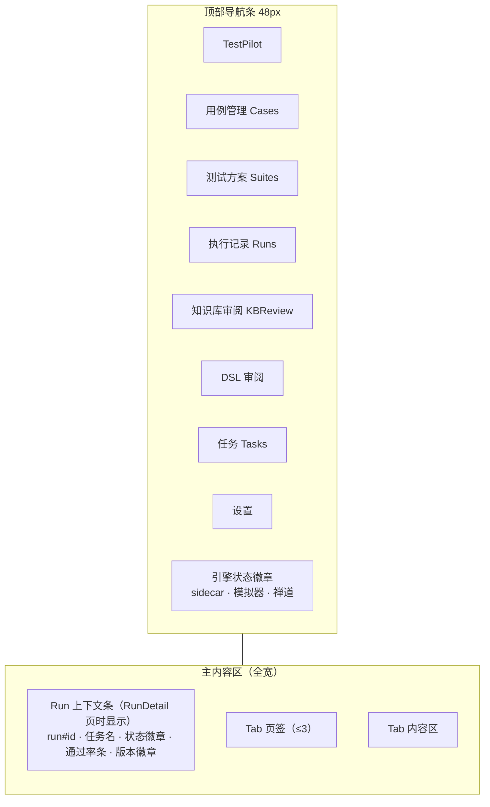

顶部导航右端为常驻引擎状态徽章组（紧凑圆点 + 文字）：sidecar 心跳、模拟器连接（9300）、禅道连接（含 sync_pending 告警态）。点击展开 sidecar 日志抽屉（底部抽屉，不占导航空间）。

### 14.3 页面设计

> **实现状态（v1.7）**：八页全部落地（`app/desktop/src/pages/`，顶部导航 + 常驻 `Telemetry` 引擎状态徽章 + 日志抽屉），并接线全部引擎能力。相对设计稿的增补：RunDetail 增设**稳定性列/抖动卡**、**两次 run 回归对比面板**、**失败复跑徽章与「第几次执行」切换**；KBReview 增设 **case_ctx（用例上下文）**页签；**env_compat 通过率矩阵落在 RunDetail 概览卡**（`RunDetailPage`，非 KBReview 页签）；Settings 由 `config.describe` 的 **34 字段/9 分组**驱动，含覆盖层 YAML「高级」页签（密钥字段不进入表单）。

| 页面 | 布局 | 关键组件 |
|---|---|---|
| **Cases 用例管理** | 全宽表格 + 工具条 | 工具条：按 ID 拉取（输入禅道 ID/多 ID 粘贴）、增量同步按钮（含上次同步时间）；列：用例、标题、DSL 版本、**sync_status 徽章**（synced 绿/stale 黄/conflict 红）、状态、更新时间；stale/conflict 行提供"重新解析 DSL"入口（跳 DslReview）；行点击看用例详情（步骤原文 + DSL 并列） |
| **Suites 测试方案** | 左方案列表 + 右详情（双栏） | 左：方案名、用例数、更新时间；右：有序用例列表（拖拽排序、增删）、前置条件编辑（模拟器场景标签选择）、方案级驱动配置（mode 下拉）；工具条：从 Cases 多选"创建为方案"；方案卡片提供"一键建任务" |
| **Runs 列表** | 全宽表格 | 列：run_id、任务名（含方案名）、状态徽章、通过率堆叠条（绿/红/黄/灰分段 + pass/total 数字）、KB 命中率、LLM 成本、时间；行点击/Enter 进详情 |
| **RunDetail · Tab1 概览** | 统计卡行 + 两个横条区 | 紧凑计数卡（通过/失败/阻塞/跳过）；根因分布横条（分类×次数）；环境快照徽章组（被测版本/模拟器版本/驱动模式/DPI） |
| **RunDetail · Tab2 用例明细** | 全宽表格 | 列：用例、DSL 版本、状态徽章、耗时、失败签名（等宽）、KB 命中（深链）；失败行浅红底；行点击切 Tab3 并定位到该用例轨迹 |
| **RunDetail · Tab3 轨迹回放** | 左时间线（42%）+ 右详情 | 左：紧凑行 `#s5 · ui.click · [uia→vis] · 3.4s · ✗`，常显 source_text（禅道用例原步骤说明，灰色小字对照，非展开交互），失败/阻塞行浅色底，device 步骤显示驱动徽章；右：error_json 折叠块、before/after 双截图对照（可切差异高亮）、**device 步骤状态快照（device_state_json）**、证据链（相似历史 → 处置建议）。注：device 指令回执（`{step_id, cmd, ok, ms[, error]}`）已落 `step_trace.receipt_json`（失败同样留回执，`ms` 缺失时以引擎实测 `act_ms` 兜底），经 `run.stepTrace` 下发布侧"设备指令回执"面板（成功/失败徽章 + 指令 + 耗时 + 错误），报告的步骤明细也追加回执行 |
| **KBReview** | 左队列列表 + 右详情（双栏） | 左：签名 + 根因分类 + 置信度徽章；右：根因草稿、证据链跳转、相似历史 TOP3、处置策略下拉（block_known/retry_ready/skip）+ 通过/驳回（内联确认条，不用大弹窗） |
| **DslReview** | 左原文只读 + 右 DSL 步骤列表 | 左：禅道用例原文；右：DSL 步骤卡片（每步带 source_text 对照）；LLM 不确定步骤黄徽章高亮；版本号与 diff 视图切换 |
| **Tasks** | 全宽表格 + 工具条 | 任务列表（禅道任务 ID 深链、来源方案、状态、调度）；sync_pending 行显示补偿按钮；新建任务对话框（**选方案下拉或临时选用例** / 驱动模式下拉） |
| **Settings** | 分组表单 | 9 分组 34 字段（被测程序/驱动路由/UIA/视觉/对话模型/禅道/模拟器/知识库/日志），由 `config.describe` 驱动生成；密钥类字段不进入表单（不在 `EDITABLE`，写入被引擎拒绝）；含覆盖层 YAML「高级」页签与恢复默认 |

### 14.4 组件规范

| 组件 | 规范 |
|---|---|
| 状态徽章 | 高 20px、圆角 4px、字号 12px、描边 + 8% 浅底；文案固定枚举（pass/fail/blocked/skip/unknown/completed/running/synced/stale/conflict） |
| 驱动徽章 | 等宽字体、10px、灰底：`uia` `vision` `template` `emu`；降级显示 `uia→vis` |
| 通过率条 | 高 8px 分段堆叠条（绿/红/黄/灰）+ 右侧 `14/20` 等宽数字 |
| 时间线行 | 高 32px：`#序号 · action · 驱动徽章 · 耗时 · 状态徽章`；失败行 6% 红底、阻塞行 6% 黄底 |
| 截图对照 | 等宽双列（before/after 标签置角）；差异模式叠加高亮框 —— 由引擎 `run.shotDiff` 预计算（与 Verifier 共用同一套阈值语义）并按 `diff_{step}.png/json` 缓存；点击缩略图开 Lightbox |
| 计数卡 | 紧凑数字卡（数值等宽字体 + 标签 12px），不做大 KPI 头 |
| 确认操作 | 危险操作（驳回知识、删除模板）用内联确认条；不用居中大弹窗 |
| 深链 | 证据链/KB 命中/用例明细全部 `?runId&caseExecId&stepNo` 参数化路由，可从报告复制直开 |

### 14.5 交互约定

- 快捷键：`Ctrl+K` 快速跳转 run（✅）；列表 `Enter` 进详情；`Esc` 关抽屉
- RunDetail 多 Tab 记忆最后停留页；从用例明细行点击自动切轨迹 Tab 并定位（✅ 深链 `#/run?runId&caseExecId&stepNo`）
- 引擎状态徽章为唯一全局告警入口：sync_pending / sidecar 健康在此呈现，点击开日志抽屉（✅）
- 时间显示本地时区；所有 ID（run/case/step/签名）一键复制（✅ `CopyId` 组件）；危险操作用内联确认条，Toast 轻提示

### 14.6 页面线框图

**框架总览（1280×800 基准，所有页面共用骨架）**

```text
┌ TestPilot ───────────────────────────────────────────────────────┐
│ TestPilot  用例管理 测试方案 执行记录 知识库审阅 DSL审阅 任务 设置  ●引擎 ○模拟器 ⚠禅道 │ ← 顶部导航 48px
├──────────────────────────────────────────────────────────────────┤
│ 主内容区（全宽）                                                   │
│  Run 上下文条（RunDetail 页时显示）                                 │
│    run#12 · 常规样本回归 · [completed] ▓▓▓▓▓▓▓░░ 14/20 · v2.3.1   │
│  Tab 页签区（≤3）                                                  │
│  Tab 内容区（轨迹回放/用例表格等获得全宽水平空间）                    │
│                                                                  │
│  （引擎状态徽章常驻导航右端；点击展开底部日志抽屉）                   │
└──────────────────────────────────────────────────────────────────┘
```

**Cases · 用例管理**（内容区全宽表格）

```text
工具条: [按 ID 拉取: 输入禅道用例ID/粘贴多个] [增量同步 ↑ 上次 09-08 14:20]
──────────────────────────────────────────────────────────────
用例ID   标题                 DSL版本  同步状态    状态     更新时间
TC-1024  常规样本A检测全流程   v3      [synced]   active   09-07
TC-1025  缺试剂报警验证       v1      [stale]    active   09-08  ← 行尾[重新解析]
TC-1031  探针堵塞恢复         v2      [conflict] draft    09-09  ← 行尾[三版对照]
──────────────────────────────────────────────────────────────
行点击 → 用例详情（左:禅道步骤原文 | 右:DSL步骤 含 source_text 对照）
勾选多行 → 工具条出现 [创建为测试方案]
```

**Suites · 测试方案**

```text
[左栏: 方案列表]              [右栏: 方案详情]
  ▸ 冒烟回归 (12)               名称: 冒烟回归        [编辑] [一键建任务]
  ▸ 全量回归 (86)               用例(有序, 拖拽排序):
  ▸ 报警场景 (9)                  1. TC-1024 常规样本A...     [×]
    (+ 新建方案)                   2. TC-1025 缺试剂报警...    [×]
                                  [+ 添加用例]
                                前置条件: [normal_sample_a] [probe_block] (+)
                                驱动配置: mode ▾ uia_first
```

**RunDetail · Tab3 轨迹回放**

```text
[左: 步骤时间线 42%]            [右: 详情 58%]
 TC-1024 步骤轨迹               ✗ verify_failed
 #s1 app.launch    [uia] 3.2s ✓  expect「S001」· 实际表格为空
 #s2 app.wait_ready[uia] 8.4s ✓  ┌───────────┬───────────┐
 #s3 device.scene  [emu] 210ms ✓ │ before    │ after     │
 #s4 ui.input      [uia] 180ms ✓ └───────────┴───────────┘
 #s5 ui.click      [uia→vis] 3.4s ✗   [切换: 差异高亮]
    └ 原文: 点击"开始检测"按钮      模拟器回执: set_sample ok 8ms
 #s6 assert.ui     ⚠ (blocked)     状态快照: {"run":"idle","sample":"S001"}
    └ 原文: 检查结果表格包含S001    相似历史 3次 → run#9·TC-1024·s5
                                  处置建议: 步骤前插入 app.wait_ready
```

**KBReview · 知识库审阅**

```text
[左: 待审队列]                  [右: 审阅详情]
 sha:a3f8c2d1 签名               签名: verify_failed|ui.click|btn.start_detect@main
 sha:9e12b7... [uia_change]      根因草稿: UI 变更(LLM) 置信度0.62
 sha:4c01d9... [timing]          证据链: run#12 → TC-1024 → s5 截图对照 ↗
 (已完成/已驳回折叠)             相似历史 TOP3: ↗ run#9 ↗ run#4 ↗ run#2
                                处置: [block_known ▾]
                                [✓ 通过生效] [✗ 驳回]  ← 内联确认条
```

---

## 附录 A：被测软件与模拟器适配需求

### A.1 被测软件（C++/Qt）

**P0（M1 前必须）：**
- UIA 可达性检查（Accessibility Insights for Windows 验证控件树）
- 可交互控件设置 `accessibleName`；QML Item 设 `Accessible.name/role`；写入编码规范
- `--test-mode` 启动参数：跳登录/激活/升级弹窗、固定测试数据、禁自动更新
- 窗口标题固定、单实例

**P1（M2~M3）：**
- 就绪信号（busy/idle）暴露：UIA 属性或测试端口查询
- 本地测试端口（HTTP/WebSocket）：dump 内部状态、数据重置
- 时间可控（业务时钟注入、禁用/加速动画）；测试模式固定随机种子

**P2（M4）：**
- 结构化日志带步骤 ID；崩溃非零退出码 + dump 路径
- 弹窗统一自研 MessageBox

### A.2 设备模拟器（Qt + QWebView）

**控制方式定案：带外 WebSocket 接口为主通道，接口直控模拟核心（设备状态机），绕过 WebView 界面层。**

| 方案 | 结论 | 理由 |
|---|---|---|
| 开接口（WebSocket） | ✅ 主通道 | 自研配套件有源码配合权；毫秒级、确定性最高；绕过 WebView 直控模拟核心，不受界面改版影响 |
| UIA 控制 | ❌ 仅窗口级兜底 | QWebView（Qt WebKit）内 DOM 元素不映射 UIA 树，界面级控制不可靠；仅用于启动/关闭/截图取证 |
| MCP | ❌ 不进主链路 | MCP 是 LLM agent 工具协议；主链路是确定性引擎，多一层抽象无收益。M5+ 若集成 piagent，可将同一接口包成 MCP server 暴露（语义不变） |

改造要求：

- QWebSocketServer（或独立线程 HTTP）监听 9300，与设备协议通道分离
- 接口必须直连模拟核心（设备状态机），**不经过 QWebView 界面层**
- 指令集：`load_scene` / `set_sample` / `inject_error` / `query_state` / `history` / `disconnect` / `set_delay` / `time_scale`
- 场景预设库（用例前置条件 → 一键加载）
- 错误注入矩阵（错误码/超时/断连/残缺报文）
- 状态查询 + 交互历史（取证）
- 长耗时操作时间压缩（`time_scale`）；多实例端口可配置（并行回归）
- 需要验证 WebView 渲染正确性时，走视觉驱动截图比对（不走 UIA）

### A.3 模拟器控制接口规范

#### A.3.1 传输与信封

WebSocket `ws://127.0.0.1:9300`（多实例：9300 + n，配 `instance_id`），JSON 文本帧，**一请求一回执（半双工、FIFO）**：

```json
// 请求
{"id": 42, "cmd": "set_sample", "args": {"type": "A", "barcode": "S001"}, "ver": "1.0"}
// 成功回执
{"id": 42, "ok": true, "data": {"sample_id": "SIM-S001"}, "elapsed_ms": 8}
// 失败回执
{"id": 43, "ok": false, "err": {"code": "E_STATE", "msg": "运行中不允许换样本"}, "elapsed_ms": 2}
```

- `id`：自增请求号（客户端生成），回执按 id 对齐——Python 侧同步调用即"发送 → 阻塞 recv → 校验 id"
- `ver`：协议版本，握手不通过拒绝连接
- 超时：指令级（默认 10s，可按指令覆盖）；超时即连接作废、重连重试

#### A.3.2 握手与能力上报

连接后客户端必须先发 `hello`，服务端回执携带能力清单（另提供 HTTP `GET /capabilities` 供离线缓存）：

```json
{"id": 1, "cmd": "hello", "args": {"client": "testpilot", "ver": "1.0"}}
```

```json
{"id": 1, "ok": true, "data": {
  "protocol": "testpilot-emu/1.0",
  "device": "XYZ-Analyzer",
  "commands": [
    {"cmd": "set_sample", "desc": "装载/更换样本",
     "args_schema": {"type": "object", "properties": {
        "type": {"enum": ["A", "B", "C"]},
        "barcode": {"type": "string"},
        "errors": {"type": "array",
                    "items": {"enum": ["E_REAGENT", "E_PROBE", "E_EMPTY"]}}}},
     "example": {"type": "A", "barcode": "S001", "errors": []}},
    {"cmd": "inject_error", "desc": "注入设备错误(可叠加)", "...": "..."}
  ],
  "scenes": [
    {"id": "normal_sample_a", "desc": "常规样本A · 无异常 · 通信正常"},
    {"id": "probe_block",     "desc": "探针堵塞 · 报警 E_PROBE"}
  ],
  "terms": {
    "孵育":   "长耗时温育阶段，用 time_scale 压缩",
    "缺试剂": "错误码 E_REAGENT"
  }
}}
```

清单即 11.2 所述 LLM 注入源：**指令语义、参数约束、场景、术语全部来自模拟器侧自描述**，测试平台不硬编码任何设备知识。

#### A.3.3 指令表

| cmd | args | 语义 | data 回执 |
|---|---|---|---|
| `hello` | client, ver | 握手/能力协商 | capabilities |
| `load_scene` | scene_id | 恢复出厂态后套用场景预设 | 状态摘要 |
| `set_sample` | type, barcode, errors[] | 装载/更换样本（可带初始错误） | sample_id |
| `inject_error` | code, times | 注入设备错误（可叠加） | active_errors |
| `clear_errors` | — | 清除全部注入错误 | active_errors |
| `query_state` | path | 路径式内部状态查询 | value |
| `history` | limit | 全量交互历史（取证回放） | events[] |
| `disconnect` | ms | 模拟设备断连 N 毫秒 | scheduled |
| `reconnect` | — | 提前恢复连接 | — |
| `set_delay` | op, ms | 指定操作附加固定延迟 | — |
| `time_scale` | factor | 时间压缩（factor=3600 → 30min 变 0.5s） | factor |
| `reset` | — | 恢复出厂态（清场景/错误/历史） | — |

历史事件带 `source` 字段（`rpc` / `ui_manual`）：**允许测试人员同时经 WebView 界面手动操作模拟器**，取证时可区分自动化指令与人工干预。

#### A.3.4 错误码

| code | 含义 | 客户端处置 |
|---|---|---|
| `E_CMD` | 未知指令 | 协议不匹配，核对 ver 与能力清单 |
| `E_ARGS` | 参数校验失败 | DSL 问题 → 人审 |
| `E_STATE` | 当前设备状态不允许该指令 | 用例前置/时序问题 |
| `E_SCENE` | 场景不存在 | manifest 不同步，重新拉取 |
| `E_BUSY` | 指令排队超限 | 重试或检查断连设置 |

#### A.3.5 执行时序语义（并行 / 串行）

| 层级 | 模式 | 说明 |
|---|---|---|
| 步骤间 | **串行** | DSL 顺序执行：每步回执 + 动作验证通过才进下一步（确定性优先，设计原则 1） |
| 通道间 | **天然独立** | UIA（被测软件）与 WS（模拟器）两条连接互不阻塞；"先注入样本 → 再等 UI 出结果"用步骤顺序表达，模拟器指令瞬时完成，wall-clock 几乎零占用 |
| 模拟器单实例内 | 指令串行（FIFO） | 避免设备状态竞争；模拟器内部实现可并发，对外语义按到达顺序 |
| 用例间 | 串行 | 默认逐用例执行 |
| run 间 | 可并行，需多实例 | 模拟器多实例（9300+n + instance_id）；被测软件须支持多实例（单实例约束的 app 不支持并行 run） |

DSL 保持串行语义是**有意设计**：wall-clock 收益主要来自 `time_scale` 压缩长耗时设备操作（孵育 30min → 秒级），而非并发指令；并发只会牺牲可重复性。

---

## 附录 B：复用现有资产

| 资产 | 来源 | 复用方式 |
|---|---|---|
| 禅道 API 基建（认证/重试/分页） | IssuePilot `plugins/zentao` | 移植的 async `ZentaoClient`（bug 域）在引擎中零引用，M2-3 收编时**删除**；`zentao_adapter.py` 的同步实现为唯一实现（Token 优先 + account/password 换 Token + 401/403 重登重放 + 分页 + 回读校验 + 回写重试） |
| 注册表/manifest/一致性测试模式 | IssuePilot `core/` | 本设计 2.4 节延续同一套工程约定；`tests/conformance/test_driver_conformance.py` 门禁 |
| 知识库存储结构 | ZentaoDsh 知识库改造 | provider 列、条目+命中计数模式平移（`kb_entry` + `router_stats`） |
| sidecar 打包与便携分发 | ZentaoDsh 打包链 | PyInstaller onedir + **Tauri `bundle.resources` 递归 glob**（实测 `externalBin` 会丢 `_internal/`，见 13 章）；沿用"免预装 Python/Node、dist 顶层输出"硬约束与 E-SafeNet 单次完整写经验 |
| UI 交互规范 | ZentaoDsh 桌面端 | React 实现同一套约定：紧凑徽章式状态、长内容 2~3 Tab 分栏；导航布局按 v1.5 调整为顶部导航（内容区全宽）；图表为手写零依赖 SVG |
| LLM agent 通道 | ZentaoDsh agent | LlmGateway 对接现有模型配置；M5+ 探索工具层复用同一驱动/模拟器能力 |

---

## 附录 C：实现状态对照（v1.6 校对）

> 校对基准：`testpilot/` 代码库（M1~M4 + 第七~十轮增强）。开发机验证证据：单测 668 全绿 / ruff 0 / 前端 `tsc+vite` 通过 / Rust 壳测试 7 项通过 / 预检 74 项通过 / PyInstaller + `tauri build` 产出约 55 MB NSIS 安装包 / 端到端冒烟（壳拉起 sidecar + RPC 9301 监听 + 建库）通过。

### C.1 未实现 / 未验证项（均有归属，无桩代码）

| 项 | 归属 | 说明 |
|---|---|---|
| **安装包在干净机器上的验证** | M4-1 尾项 | 本机已装开发环境，结论不可信；需一台无 Python/Node 的机器实测安装与运行 |
| **UIA 实机联调** | M1-5 前置 | 代码路径与门禁就绪，需被测软件 P0 适配（accessibleName / `--test-mode` / 固定窗口标题） |
| **DPI 真实多缩放对齐** | M3-4 尾项 | 逻辑与 125/150/200/250% 换算已单测；需真机跑一次回归确认像素对齐 |
| **M5+ piagent agent 运行时** | M5+ | 工具层已就绪（`explore/`：工具白名单 / 会话固化回 DSL / 模拟器 MCP server）；agent 运行时由外部接入，探索产物仍走 `case accept` 人审 |

> v1.8 起，此前的 6 项"设计有、实现无"（壳侧独立运行指标、9.4 快速定位体验、9.2 embedding 钩子、
> 11.2 device.* manifest 校验、能力清单按用例过滤、device 指令回执落库/展示）**已全部落地**，
> 实现位置与口径见 v1.8 变更行及 9.2 / 9.4 / 10 / 11.2 / 14.3 各节"实现状态"。

### C.2 与设计文档的差异（本文档已按实现校正）

| 主题 | 设计稿原描述 | 实现现状 | 本文档更新位置 |
|---|---|---|---|
| 打包形态 | `externalBin` 挂载 sidecar | **`bundle.resources` 递归 glob**（externalBin 会丢 onedir 的 `_internal/`，决策 D7/D11） | 2.5 / 13 / 附录 B |
| 调度 | APScheduler / 系统 cron | 内置 `app/scheduler.py`（可 `schedule --once` 配合 cron） | 2.2 |
| 图表 | ECharts（应用内） | 手写零依赖 SVG（通过率环/根因条形/耗时拆分条），未引入 ECharts | 2.2 |
| RPC 方法名 | `run.list/detail` + `case.detail/step.detail` | 报告组收敛为 `run.caseDetail` / `run.stepTrace`（消歧）；实际 43 个方法 | 2.5 |
| 事件 | `run.progress/case.finished/step.finished/llm.usage` | 前三个已实现；`llm.usage` 改为 `stats.llm_usage` 随 run 统计落库（未单发事件） | 2.5 / 10 |
| 任务创建 | 禅道建任务为前置 | **本地优先**：默认只落本地（`sync_status='local'`），禅道可用且开启时建远端、失败降级 `sync_pending` | 3.5 / 8.11 |
| 数据模型 | 早期 DDL | 新增：`dsl_case.raw_json/accepted_steps_json/preconditions_json/notes`、`test_task.preconditions_json/sync_status`（`zentao_task_id` 可空）、`case_exec.root_cause_json/attempts/retry_json`、`step_trace.attempt/verify_detail/source_text/step_kb_hit/driver_chain_json/receipt_json` | 3.4 |
| 设备回执 | 早期设计只在 14.3 提"回执校验" | 回执落库 `step_trace.receipt_json`（`{step_id,cmd,ok,ms,error?}`），`ctx.extra["device_receipts"]` 保留兼容；RPC/报告/RunDetail 三处消费 | 3.4 / 8.1 / 14.3 |
| 语义召回 | 9.2 预留"embedding 钩子"未给接口 | 落为 `EmbeddingProvider` 协议 + `KnowledgeService(embedding=...)` 构造注入，**默认不装配**（无模型也零影响） | 9.2 |
| 壳侧指标 | 10 章列 Tauri 侧指标但未定落盘位置 | `<数据根>/logs/shell.log`（JSONL 状态迁移）+ `shell_metrics` 命令（重启/RPC 时延计数/日志路径），前端日志抽屉展示 | 10 |
| 禅道 HTTP 基建 | 设计保留 `zentao_http.py`（IssuePilot async 移植件）待收编 | 收编落地：移植件全仓零引用已删除，`zentao_adapter.py` 同步 `ZentaoHttp` 为唯一实现（功能等价：认证自愈/分页/重试/回读校验） | 8.10 / 附录 B |
| DSL 模型 | `Step`/`TestCase` 基础字段 | 新增 `Step.uncertain`、`TestCase.notes`（LLM 解析与结构校验的不确定标记） | 7.1 |
| 契约值对象 | `ExecContext.abort=None` 等 | 新增 `NullAbort`（core 不依赖 infra）、`ExecContext.attempt/check_abort()`、`StepResult.driver_chain/target_json`、`CaseExecResult.root_cause` | 7.2 |
| Recorder 端口 | 6 个方法 | 扩展为 8 个（`record_step(attempt)`、`record_attempts`、`finish_case(duration_ms, root_cause)`） | 5.6 / 7.2 |
| DriverManifest | 定义在 `core/registry.py` | 值对象定义在 `core/contracts.py`，`core/registry.py` 再导出 | 7.2 / 7.3 |
| 路由三级覆盖 | global < case < step | 已实现：`step.driver` > 方案/任务 `hints.driver_mode` > `cfg.driver.mode` | 8.2 增补 |
| 日志输出 | stdout | **stderr**（stdout 留给 CLI JSON），业务字段白名单进载荷 | 7.5 |
| CLI 命令 | `sync/create/run/report/kb` | 10 组命令：`db-init/doctor/case/suite/task/run/kb/explore/serve/schedule` | 2.3 |
| 目录结构 | 早期骨架 | 新增 `engine/stats.py`、`suites.py`、`case_parser.py`、`config/service.py`、`infra/{dpi,imaging,opencv,winver,events}.py`、`explore/`、`adapters/prompts.py` 等 | 2.3 |
| 设置页字段数 | 42 字段 9 分组 | **34 字段** 9 分组（`config/service.py:EDITABLE`）；密钥字段不入表单、写入被引擎拒绝 | 2.5 / 7.4 / 14.3 |
| env_compat 落点 | KBReview 页签 | **RunDetail 概览卡**（KBReview 仅 case_ctx 页签） | 2.5 / 14.3 |
| 报告截图 | 双截图 | 库与报告只引用**单张主截图**（`screenshot_after or screenshot_before`；before/after 文件均落盘，前端按路径约定重算） | 8 章汇总 / C.3 |
| 契约类型 | 具名 `RawCase/DslDraft/...` | 端口泛化为 `dict/Any/list`；`KnowledgePort` 未声明 `save_element/confirm`；`RpcService` 为 `rpc.py` 具体类（`_BLOCKING` 9 个） | 5 章 |
| 日志白名单 | 骨架 8 键 / 尾注 15 键 | 实现 **22 键**（多 `case_exec_id/task_id/suite_id/phase/count` 等；`run_id_` 无生产者属残留键） | 7.5 |
| UIA 增项表述 | `read_text`/`index`/`ready_control` 三方法 | `read_text` 是方法；`index` 是 locator 字段（映射 `found_index`）；`ready_control` 是配置键 | 2.3 / 8 章汇总 |

### C.3 设计有、但实现做了加强的项

| 设计项 | 实现加强 |
|---|---|
| 双驱动路由学习 | 每次驱动尝试都回写 `router_stats`（含动作失败）；`avg_locate_ms` 增量均值；UIA 连续失败后视觉提前但仍留队尾兜底 |
| 视觉 L1/L2 成本阶梯 | 新增 **L2→L1 自动沉淀**（VLM 命中后裁剪存模板，下次同语义元素直走模板）、模板超时轮询、PIL 截图后备、中文路径读写 |
| 轨迹记录 | 新增驱动尝试链、`verify_detail`、`step_kb_hit`、每次尝试摘要（`retry_json`）、`target_json` 快照 |
| 归因 | 知识库命中直接给参考且不重复入库；类别→处置映射；相似历史 TOP N；规则高置信可直接 `active` |
| 知识库 | `case_ctx` 人审维护（场景/已知坑/备注，执行期场景预加载 + 归因注入）；`env_compat` 通过率矩阵；`hits` 计数 |
| 报告 | 驱动降级统计 / 原文对照 / 主截图内联 / 归因分布 / 稳定性段 / env 矩阵 / 复跑记录 |
| 失败处理 | **失败用例复跑（flake 过滤）**：默认关闭，上限 3，三级覆盖；复用同一 `case_exec`（一条用例一票），稳定性把"复跑后才通过"判为 `flaky` |
| 回归质量 | **用例稳定性**（stable/flaky/broken/unknown）与**两次 run 对比**（新增失败/修复/持续失败）按需计算、不落库 |
| 桌面壳 | 八页 + 顶部导航 + 引擎状态徽章/日志抽屉；截图差异高亮 `run.shotDiff`；env_compat 矩阵落 RunDetail 概览；设置页配置覆盖层（34 字段/9 分组，密钥不进入表单） |
| 测试与门禁 | `tests/conformance/test_driver_conformance.py` 驱动一致性测试；打包三清单交叉校验；`tools/verify.py`（ruff stdin 通道 + pytest） |

### C.4 有意不做（不是缺口）

| 项 | 原因 |
|---|---|
| MCP 进主链路 | 主链路是确定性引擎，多一层抽象无收益；M5+ 仅作 agent 的另一种接入形态（附录 A.2） |
| ECharts 等图表库 | 手写 SVG 已覆盖应用内图表需求，省一个前端依赖 |
| 禅道写执行明细 | 禅道只做管理视图（设计原则 5），明细仅本地 |
| 引擎侧暴露 `shutdown`/`dsl.review` 等于前端 | 属"引擎有、界面按需不暴露"的 RPC，避免误当缺口重复实现（第四轮已区分记录） |

---

*文档结束。M1~M4 代码已落地；v1.7 完成逐项复核与勘误，v1.8 补齐当时补录的 6 项设计缺口并完成 M2-3 收编。剩余事项（实机联调 / 干净机器验证 / M5+ agent 运行时等）见附录 C.1。*
